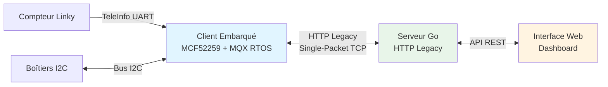

# client-essensys-legacy

[](https://opensource.org/licenses/MIT)
[](https://github.com/essensys-hub/client-essensys-legacy/)

## Description

Système domotique embarqué basé sur MQX RTOS pour microcontrôleur Coldfire MCF52259. Ce projet comprend un client embarqué (BP_MQX_ETH) qui communique avec un serveur via un protocole HTTP legacy avec des contraintes critiques spécifiques.

Le système gère le contrôle de l'éclairage, du chauffage (fil pilote), des alarmes, et l'intégration avec le compteur Linky via TeleInfo.

## Table des Matières

- [Contexte et Motivation](#contexte-et-motivation)
- [Architecture](#architecture)
- [Contraintes Critiques](#contraintes-critiques)
- [Getting Started](#getting-started)
  - [Prérequis](#prérequis)
  - [Installation](#installation)
- [Documentation](#documentation)
- [Exemples](#exemples)
- [Contribution](#contribution)
- [Licence](#licence)
- [Remerciements](#remerciements)

## Contexte et Motivation

Ce projet est né du besoin de créer un système domotique fiable et performant pour la gestion d'installations résidentielles françaises. Le système contrôle l'éclairage, le chauffage via fil pilote, les alarmes, et s'intègre avec le compteur électrique Linky.

**Pourquoi ce projet ?**

- **Système embarqué temps réel**: Utilisation de MQX RTOS pour garantir des temps de réponse déterministes
- **Contraintes matérielles**: Optimisé pour fonctionner sur un microcontrôleur MCF52259 avec mémoire limitée
- **Intégration française**: Support natif du fil pilote et du protocole TeleInfo (Linky)
- **Extensibilité**: Architecture modulaire avec support I2C pour boîtiers auxiliaires
- **Fiabilité**: Conçu pour fonctionner 24/7 avec gestion d'erreurs robuste

**Défis techniques relevés:**

Le développement a révélé des contraintes critiques liées aux limitations du client embarqué, notamment la nécessité d'envoyer toutes les réponses HTTP en un seul paquet TCP. Cette documentation capture ces découvertes pour faciliter la maintenance et l'évolution du système.

## Architecture

Le système est composé de trois éléments principaux:

1. **Client Embarqué (BP_MQX_ETH)**: Microcontrôleur MCF52259 Coldfire avec MQX RTOS
2. **Serveur Go**: Serveur HTTP implémentant le protocole legacy
3. **Interface Web**: Dashboard de contrôle et d'administration



**Pour une vue détaillée de l'architecture complète**, consultez le [diagramme système complet](docs/diagrams/system-overview.md) qui montre toutes les tâches MQX, les modules, et les flux de données.

## Contraintes Critiques

⚠️ **Ce système a des contraintes uniques qui doivent être respectées:**

### 1. Single-Packet TCP Requirement

**CRITIQUE**: Toutes les réponses HTTP du serveur **doivent être envoyées en un seul paquet TCP**.

Le parser HTTP du client embarqué est simple et ne peut pas gérer les réponses fragmentées. Si une réponse arrive en plusieurs paquets, le client se bloque et cesse de communiquer.

**Solution**: Le serveur utilise un `legacyResponseWriter` qui bufferise toute la réponse avant de l'envoyer.

📖 Voir [tcp-single-packet.md](docs/protocol/tcp-single-packet.md) pour l'analyse complète avec tcpdump.

### 2. JSON Malformé

Le client envoie du JSON **non-standard** avec des clés non-quotées:
```json
{_de67f:1, _de605:0, _de606:1}  // ❌ Non-standard
```

Le serveur doit normaliser ce JSON avant de le parser:
```json
{"_de67f":1, "_de605":0, "_de606":1}  // ✅ Normalisé
```

📖 Voir [http-legacy-protocol.md](docs/protocol/http-legacy-protocol.md) pour les détails.

### 3. Table d'Échange Complète

Lors de l'envoi d'actions via `/api/myactions`, le serveur doit **toujours** envoyer la table d'échange complète (indices 605-622), même si une seule valeur change. Les valeurs sont mergées avec un bitwise OR côté client.

📖 Voir [exchange-table.md](docs/protocol/exchange-table.md) pour la logique de merge.

### 4. Headers HTTP Spécifiques

Le header `Content-Type` doit avoir un **espace** avant le point-virgule:
```
Content-Type: application/json ;charset=UTF-8  // ✅ Correct (espace avant ;)
Content-Type: application/json;charset=UTF-8   // ❌ Incorrect
```

## Getting Started

### Prérequis

#### Pour le Client Embarqué

- **IDE**: CodeWarrior Development Studio ou équivalent pour Coldfire
- **Toolchain**: Compilateur C pour MCF52259 (m68k-elf-gcc)
- **MQX RTOS**: Freescale MQX 3.x ou supérieur
- **Hardware**: 
  - Carte de développement MCF52259EVB ou équivalent
  - Programmeur JTAG/BDM (P&E Micro, Segger J-Link)
  - Câble Ethernet
  - (Optionnel) Compteur Linky avec sortie TeleInfo
  - (Optionnel) Boîtiers auxiliaires I2C

#### Pour le Serveur

- **Go**: Version 1.19 ou supérieure
- **Outils réseau**: tcpdump, Wireshark (pour le debugging)
- **OS**: Linux, macOS, ou Windows

#### Pour le Développement

- **Git**: Pour cloner le dépôt
- **Éditeur**: VSCode, Vim, ou tout éditeur supportant C et Go
- **Documentation**: Navigateur supportant Mermaid (GitHub, VSCode)

### Installation

#### 1. Cloner le Dépôt

```bash
git clone https://github.com/votre-username/client-essensys-legacy.git
cd client-essensys-legacy
```

#### 2. Compiler le Client Embarqué

```bash
# Ouvrir le projet dans CodeWarrior
# Sélectionner la configuration: m52259evb_Int_Flash_Debug
# Build → Build Project
# Le fichier .elf sera généré dans m52259evb_Int_Flash_Debug/
```

#### 3. Flasher le Client

```bash
# Via CodeWarrior debugger ou outil de flash externe
# Connecter le programmeur JTAG/BDM
# Flash → Program Flash
```

#### 4. Configuration Réseau

Le client utilise une adresse MAC stockée dans l'EEPROM SPI. Configurez l'adresse IP via:
- DHCP (par défaut)
- IP statique (modifier dans `H/Hard.h`)

#### 5. Lancer le Serveur Go

```bash
cd server/  # Si vous avez un dossier serveur séparé
go build
./server --port 8080
```

#### 6. Vérifier la Communication

```bash
# Capturer les paquets pour vérifier le single-packet requirement
sudo tcpdump -i eth0 -A host <client-ip>

# Le client devrait commencer à poller /api/mystatus toutes les 1-2 secondes
```

### Configuration

#### Client Embarqué

Les paramètres principaux sont dans:
- `H/Hard.h`: Configuration hardware (GPIO, ADC, PWM)
- `H/application.h`: Configuration application (timeouts, polling)
- `Ethernet/GestionSocket.h`: Configuration réseau (IP serveur, ports)

#### Serveur

Configuration via variables d'environnement ou fichier de config:
```bash
export SERVER_PORT=8080
export CLIENT_POLL_INTERVAL=2s
export LOG_LEVEL=debug
```

## Documentation

📚 **[Documentation complète en ligne](https://VOTRE_USERNAME.github.io/VOTRE_REPO/)** - Site MkDocs avec recherche et navigation améliorée

La documentation est également disponible dans le dossier `docs/` et organisée par thème:

### 📡 Protocole

- **[Protocole HTTP Legacy](docs/protocol/http-legacy-protocol.md)** - Comportement HTTP non-standard, JSON malformé, headers requis
- **[Contrainte Single-Packet TCP](docs/protocol/tcp-single-packet.md)** - Découverte critique, analyse tcpdump, solution
- **[Table d'Échange](docs/protocol/exchange-table.md)** - Indices 605-622, logique de merge, exemples d'actions

### 💻 Client Embarqué

- **[Architecture](docs/embedded-client/architecture.md)** - MQX RTOS, tâches, priorités, synchronisation
- **[Référence des Modules](docs/embedded-client/modules-reference.md)** - Alarme, Chauffage, Ecran, TeleInfo, etc.
- **[Communications](docs/embedded-client/communications.md)** - I2C, SPI, UART, Ethernet/TCP
- **[Hardware](docs/embedded-client/hardware.md)** - MCF52259, mémoire, GPIO, ADC, PWM

### 🖥️ Serveur

- **[Implémentation Go](docs/server/go-implementation.md)** - Architecture serveur, legacyResponseWriter
- **[Endpoints API](docs/server/api-endpoints.md)** - Documentation complète de tous les endpoints

### 📊 Diagrammes

- **[Vue d'Ensemble Système](docs/diagrams/system-overview.md)** - Architecture complète avec tous les composants
- **[Diagrammes de Séquence](docs/diagrams/sequence-diagrams.md)** - Flux de communication détaillés
- **[Flux de Données](docs/diagrams/data-flow.md)** - Cycle de vie des actions et états

### 🔧 Dépannage

- **[Debugging Réseau](docs/troubleshooting/network-debugging.md)** - Utilisation de tcpdump, analyse de paquets

### 📚 Ressources Additionnelles

- **[MQX RTOS Documentation](https://www.nxp.com/docs/en/user-guide/MQXRTOSUG.pdf)** - Documentation officielle NXP
- **[MCF52259 Reference Manual](https://www.nxp.com/docs/en/reference-manual/MCF52259RM.pdf)** - Manuel du microcontrôleur
- **[TeleInfo Specification](https://www.enedis.fr/sites/default/files/Enedis-NOI-CPT_54E.pdf)** - Spécification du protocole Linky

## Exemples

### Exemple 1: Allumer une Lumière

Pour allumer la lumière connectée à l'index 607:

```bash
# Via l'API admin du serveur
curl -X POST http://server:8080/api/admin/inject \
  -H "Content-Type: application/json" \
  -d '{
    "_de67f": 1,
    "_de607": 1,
    "_de613": "guid-12345"
  }'
```

Le serveur inclura cette action dans la prochaine réponse `/api/myactions`. Le client:
1. Reçoit l'action
2. Merge `_de607=1` avec sa table locale (bitwise OR)
3. Active la sortie GPIO correspondante
4. Envoie un acknowledge via `/api/done/guid-12345`

### Exemple 2: Lire les Données TeleInfo

Le client lit automatiquement les trames TeleInfo du compteur Linky:

```c
// Dans TeleInfo_task
void TeleInfo_task(uint_32 param) {
    while(1) {
        // Lecture UART
        char frame[256];
        read_teleinfo_frame(frame);
        
        // Parsing
        TeleInfoData data;
        parse_teleinfo(frame, &data);
        
        // Mise à jour table d'échange
        update_exchange_table(&data);
        
        _time_delay(1000); // 1 seconde
    }
}
```

Les données sont ensuite envoyées au serveur via `/api/mystatus`.

### Exemple 3: Contrôler le Chauffage (Fil Pilote)

Le système supporte 6 ordres fil pilote via PWM:

```c
// Ordres fil pilote
typedef enum {
    FP_CONFORT = 0,      // 0% PWM
    FP_ECO = 1,          // Signal spécifique
    FP_HORS_GEL = 2,     // Signal spécifique
    FP_CONFORT_MINUS_1 = 3,
    FP_CONFORT_MINUS_2 = 4,
    FP_ARRET = 5         // 100% PWM
} FilPiloteOrder;

// Envoi d'un ordre
set_fil_pilote_zone(ZONE_1, FP_ECO);
```

### Exemple 4: Debugging avec tcpdump

Pour vérifier que les réponses sont bien en un seul paquet:

```bash
# Capturer les paquets du client
sudo tcpdump -i eth0 -nn -A host 192.168.1.100

# Vérifier le nombre de paquets pour une réponse
sudo tcpdump -i eth0 -nn host 192.168.1.100 | grep "length"

# Exemple de sortie correcte (1 seul paquet):
# 14:23:45.123456 IP server.8080 > client.12345: Flags [P.], length 456
```

### Exemple 5: Scénario d'Automatisation

Créer un scénario "Départ Maison":

```c
// Dans Scenario.c
void scenario_depart_maison(void) {
    // Éteindre toutes les lumières
    for(int i = 605; i <= 612; i++) {
        set_exchange_value(i, 0);
    }
    
    // Activer l'alarme
    set_exchange_value(INDEX_ALARME, 1);
    
    // Passer en mode Hors-Gel
    set_fil_pilote_all_zones(FP_HORS_GEL);
    
    // Notifier le serveur
    send_mystatus();
}
```

### Exemple 6: Communication I2C avec Boîtier Auxiliaire

```c
// Lecture d'un boîtier I2C
uint8_t read_i2c_box(uint8_t box_addr, uint8_t reg) {
    uint8_t data;
    
    // Envoi de l'adresse du registre
    i2c_write_byte(box_addr, reg);
    
    // Lecture de la valeur
    i2c_read_byte(box_addr, &data);
    
    return data;
}

// Écriture vers un boîtier I2C
void write_i2c_box(uint8_t box_addr, uint8_t reg, uint8_t value) {
    i2c_write_bytes(box_addr, reg, &value, 1);
}
```

Pour plus d'exemples détaillés, consultez la [documentation complète](docs/).

## Contribution

Les contributions sont les bienvenues! Ce projet bénéficie de l'expérience collective pour améliorer la documentation et le code.

### Comment Contribuer

1. **Fork** le projet
2. **Créez une branche** pour votre fonctionnalité (`git checkout -b feature/amelioration`)
3. **Committez** vos changements (`git commit -m 'Ajout: nouvelle fonctionnalité'`)
4. **Push** vers la branche (`git push origin feature/amelioration`)
5. **Ouvrez une Pull Request**

### Guidelines

#### Code

- **Style C**: Suivre le style existant (indentation 4 espaces, accolades K&R)
- **Commentaires**: En français, clairs et concis
- **Fonctions**: Documenter les paramètres et valeurs de retour
- **Tests**: Tester sur hardware réel si possible

#### Documentation

- **Markdown**: Utiliser le format standard GitHub
- **Diagrammes**: Utiliser Mermaid pour la cohérence
- **Exemples**: Inclure des exemples de code fonctionnels
- **Liens**: Vérifier que tous les liens fonctionnent

#### Commits

Format recommandé:
```
Type: Description courte (50 caractères max)

Description détaillée si nécessaire.

Fixes #123
```

Types:
- `Ajout:` Nouvelle fonctionnalité
- `Fix:` Correction de bug
- `Doc:` Mise à jour documentation
- `Refactor:` Refactoring sans changement de comportement
- `Test:` Ajout ou modification de tests

### Domaines de Contribution

#### Priorité Haute

- 🐛 **Bugs critiques**: Problèmes affectant la stabilité
- 📖 **Documentation manquante**: Sections non documentées
- 🔒 **Sécurité**: Vulnérabilités identifiées

#### Priorité Moyenne

- ✨ **Nouvelles fonctionnalités**: Améliorations du système
- 🎨 **Interface**: Amélioration de l'interface web
- ⚡ **Performance**: Optimisations

#### Priorité Basse

- 📝 **Typos**: Corrections orthographiques
- 🎨 **Style**: Améliorations cosmétiques
- 📚 **Exemples**: Ajout d'exemples supplémentaires

### Signaler un Bug

Utilisez les [GitHub Issues](https://github.com/votre-username/client-essensys-legacy/issues) avec:

- **Titre clair**: Description courte du problème
- **Environnement**: Version hardware/software, OS
- **Reproduction**: Étapes pour reproduire le bug
- **Comportement attendu**: Ce qui devrait se passer
- **Comportement observé**: Ce qui se passe réellement
- **Logs**: Traces, captures tcpdump si pertinent

### Questions et Support

- **Issues**: Pour les bugs et demandes de fonctionnalités
- **Discussions**: Pour les questions générales (si activé)
- **Email**: Pour les questions privées ou sensibles

### Code de Conduite

- Respecter tous les contributeurs
- Accepter les critiques constructives
- Se concentrer sur ce qui est meilleur pour le projet
- Faire preuve d'empathie envers les autres membres de la communauté

## Licence

Ce projet est sous licence MIT. Voir le fichier [LICENSE](LICENSE) pour plus de détails.

## Remerciements

### Technologies et Outils

- **[NXP/Freescale](https://www.nxp.com/)** - Pour MQX RTOS et le microcontrôleur MCF52259
- **[Go](https://golang.org/)** - Pour le langage du serveur
- **[Mermaid](https://mermaid.js.org/)** - Pour les diagrammes dans la documentation

### Communauté

- Merci à tous les contributeurs qui ont aidé à améliorer ce projet
- Merci à la communauté domotique française pour le partage d'expérience
- Merci aux développeurs de systèmes embarqués pour leurs retours

### Inspiration

Ce projet s'inspire des meilleures pratiques en:
- Systèmes embarqués temps réel
- Protocoles de communication robustes
- Documentation technique claire et accessible

### Ressources

- **Enedis** - Pour la spécification du protocole TeleInfo
- **Forums domotiques** - Pour les discussions sur le fil pilote
- **Stack Overflow** - Pour l'aide au debugging

---

**Note**: Ce projet est un système legacy documenté pour faciliter la maintenance et l'évolution. Les contraintes techniques reflètent les limitations du hardware embarqué de l'époque et les choix d'implémentation initiaux.
