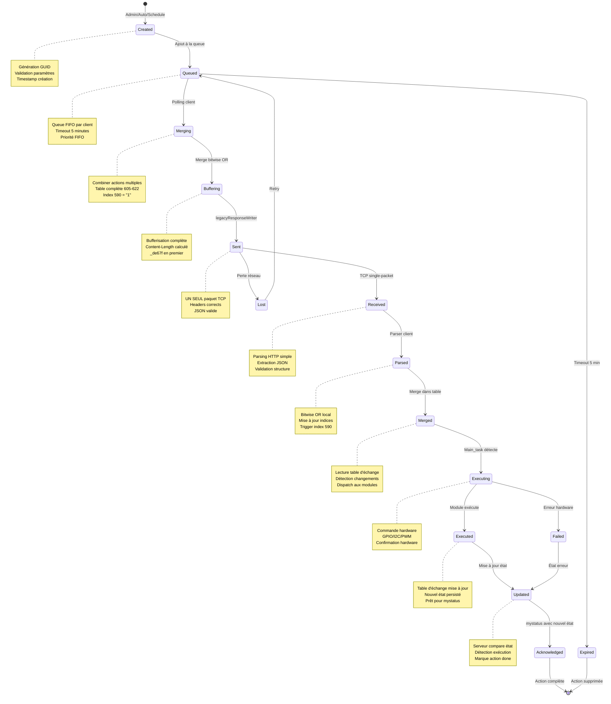

# Diagrammes de Flux de Données

Ce document présente les diagrammes de flux de données pour le système client-essensys-legacy. Ces diagrammes illustrent comment les données circulent entre les différents composants du système, de leur création à leur consommation.

## Table des Matières

- [Flux de la Table d'Échange](#flux-de-la-table-déchange)
- [Cycle de Vie d'une Action](#cycle-de-vie-dune-action)
- [Flux de Mise à Jour d'État](#flux-de-mise-à-jour-détat)

---

## Flux de la Table d'Échange

Ce diagramme montre comment les données de la table d'échange circulent entre le client embarqué et le serveur, et comment elles sont transformées à chaque étape.

```mermaid
flowchart TB
    subgraph Client["Client Embarqué BP_MQX_ETH"]
        TE[Table d'Échange<br/>Indices 0-999]
        TERead[Lecture État<br/>Indices 605-622]
        TEWrite[Écriture Actions<br/>Merge Bitwise OR]
        JSONBuild[Construction JSON<br/>Clés non-quotées]
        JSONParse[Parsing JSON<br/>Parser simple]
    end
    
    subgraph Network["Réseau TCP/IP"]
        TCPUp[TCP Upload<br/>POST mystatus]
        TCPDown[TCP Download<br/>GET myactions<br/>UN SEUL PAQUET]
    end
    
    subgraph Server["Serveur Legacy"]
        JSONNorm[Normalisation JSON<br/>Ajout quotes]
        Store[Store État Client<br/>Historique 25 valeurs]
        Queue[Queue Actions<br/>FIFO par client]
        Merge[Merge Actions<br/>Bitwise OR]
        Buffer[legacyResponseWriter<br/>Bufferisation complète]
    end
    
    subgraph External["Sources Externes"]
        Admin[Interface Admin]
        Auto[Automatisations]
        Schedule[Programmations]
    end
    
    %% Flux montant (Client → Serveur)
    TE -->|Lecture périodique| TERead
    TERead -->|Valeurs actuelles| JSONBuild
    JSONBuild -->|{version:"1.0",ek:[...]}| TCPUp
    TCPUp -->|HTTP POST| JSONNorm
    JSONNorm -->|JSON valide| Store
    Store -->|État persisté| Store
    
    %% Flux descendant (Serveur → Client)
    Admin -->|Injection| Queue
    Auto -->|Déclenchement| Queue
    Schedule -->|Programmation| Queue
    Queue -->|Actions pendantes| Merge
    Merge -->|Table complète 605-622| Buffer
    Buffer -->|Réponse complète| TCPDown
    TCPDown -->|HTTP Response| JSONParse
    JSONParse -->|Actions extraites| TEWrite
    TEWrite -->|Mise à jour| TE
    
    %% Boucle de feedback
    TE -.->|État mis à jour| TERead
    
    style TE fill:#e1f5ff
    style Store fill:#fff4e1
    style Queue fill:#ffe1e1
    style TCPDown fill:#ff9999,stroke:#ff0000,stroke-width:3px
```

### Explication du Flux

#### Flux Montant (Client → Serveur)

1. **Lecture Table d'Échange**:
   - Main_task et autres tâches mettent à jour la table d'échange localement
   - Ethernet_task lit périodiquement les indices 605-622
   - Fréquence: toutes les 1-2 secondes

2. **Construction JSON**:
   - Le client construit un JSON avec clés non-quotées (format legacy)
   - Format: `{version:"1.0",ek:[{k:605,v:"0"},{k:606,v:"1"}]}`
   - Le champ `_de67f` est toujours en premier et vaut "1"

3. **Envoi TCP**:
   - POST /api/mystatus avec le JSON malformé
   - Headers: `Content-Type: application/json`, `Connection: close`
   - Taille typique: 100-500 bytes

4. **Normalisation Serveur**:
   - Le serveur ajoute les quotes aux clés: `{"version":"1.0","ek":[...]}`
   - Parsing JSON standard après normalisation
   - Validation des indices et valeurs

5. **Stockage État**:
   - Mise à jour du store avec les nouvelles valeurs
   - Timestamp de réception enregistré
   - Historique des 25 dernières valeurs maintenu par index
   - Détection des changements pour monitoring

#### Flux Descendant (Serveur → Client)

1. **Sources d'Actions**:
   - **Interface Admin**: Injection manuelle via POST /api/admin/inject
   - **Automatisations**: Règles déclenchées par événements (ex: détection mouvement)
   - **Programmations**: Actions planifiées (ex: fermer volets à 20h)

2. **Queue Actions**:
   - Chaque client a sa propre queue FIFO
   - Les actions sont ajoutées avec un GUID unique
   - Timeout: actions non-acknowledgées supprimées après 5 minutes

3. **Merge Actions**:
   - Si plusieurs actions pour le même client, merge avec bitwise OR
   - Exemple: Action1 {621:"1"} + Action2 {621:"2"} = {621:"3"}
   - Garantit qu'aucune commande n'est perdue
   - Génère la table complète (indices 605-622 + 590)

4. **Bufferisation Complète**:
   - **CRITIQUE**: legacyResponseWriter bufferise toute la réponse
   - Calcul du Content-Length exact
   - Construction du JSON avec `_de67f` en premier
   - Envoi en UN SEUL paquet TCP (contrainte hardware)

5. **Réception Client**:
   - Le parser HTTP simple attend tout en un paquet
   - Si plusieurs paquets → client se bloque
   - Parsing JSON séquentiel
   - Extraction des actions

6. **Mise à Jour Table**:
   - Merge bitwise OR des actions dans la table d'échange
   - Les indices non-mentionnés gardent leur valeur actuelle
   - L'index 590 déclenche l'exécution du scénario
   - Main_task détectera les changements au prochain cycle

#### Boucle de Feedback

- L'état mis à jour dans la table d'échange sera envoyé au prochain mystatus
- Le serveur peut ainsi vérifier que l'action a été exécutée
- Délai typique: 1-2 secondes entre commande et confirmation

### Points Critiques

1. **Single-Packet TCP**: Sans bufferisation complète, le client se bloque
2. **JSON malformé**: Le serveur doit normaliser avant parsing
3. **Bitwise OR**: Permet d'accumuler les commandes sans perte
4. **Historique**: Les 25 dernières valeurs permettent le debugging
5. **Fréquence**: Polling toutes les 1-2 secondes = latence faible

---

## Cycle de Vie d'une Action

Ce diagramme montre le cycle de vie complet d'une action, de sa création à son exécution et son acknowledgment.



### Explication des États

#### 1. Created (Création)
- **Déclencheur**: Interface admin, automatisation, ou programmation
- **Actions**:
  - Génération d'un GUID unique (UUID v4)
  - Validation des paramètres (indices 605-622, valeurs 0-255)
  - Timestamp de création enregistré
  - Identification du client cible
- **Durée**: < 10ms

#### 2. Queued (En Queue)
- **Déclencheur**: Action validée et ajoutée à la queue du client
- **Actions**:
  - Insertion dans la queue FIFO du client
  - Attente du prochain polling mystatus
  - Surveillance du timeout (5 minutes)
- **Durée**: 0-2 secondes (dépend du polling)

#### 3. Merging (Fusion)
- **Déclencheur**: Client envoie POST /api/mystatus
- **Actions**:
  - Récupération de toutes les actions pendantes pour ce client
  - Merge avec bitwise OR si plusieurs actions
  - Construction de la table complète (indices 605-622)
  - Ajout de l'index 590 = "1" (trigger)
- **Durée**: < 50ms

#### 4. Buffering (Bufferisation)
- **Déclencheur**: Actions mergées, prêtes à envoyer
- **Actions**:
  - Construction du JSON avec `_de67f` en premier
  - Bufferisation complète de la réponse HTTP
  - Calcul du Content-Length exact
  - Préparation des headers HTTP
- **Durée**: < 50ms
- **CRITIQUE**: Sans cette étape, le client se bloque

#### 5. Sent (Envoyée)
- **Déclencheur**: Réponse bufferisée complète
- **Actions**:
  - Envoi en UN SEUL paquet TCP
  - Headers HTTP corrects
  - JSON valide avec actions
- **Durée**: < 100ms (dépend du réseau)

#### 6. Received (Reçue)
- **Déclencheur**: Paquet TCP reçu par le client
- **Actions**:
  - Réception du paquet complet
  - Vérification des headers HTTP
  - Extraction du body JSON
- **Durée**: < 10ms

#### 7. Parsed (Parsée)
- **Déclencheur**: Réponse HTTP reçue
- **Actions**:
  - Parsing HTTP simple (code 201 = actions, 200 = vide)
  - Parsing JSON séquentiel
  - Extraction du champ `_de67f`
  - Extraction du tableau `actions`
  - Validation de la structure
- **Durée**: < 50ms

#### 8. Merged (Fusionnée Localement)
- **Déclencheur**: Actions parsées avec succès
- **Actions**:
  - Merge bitwise OR dans la table d'échange locale
  - Mise à jour des indices 605-622
  - L'index 590 = "1" déclenche le scénario
  - Les indices non-mentionnés gardent leur valeur
- **Durée**: < 10ms

#### 9. Executing (En Exécution)
- **Déclencheur**: Main_task détecte les changements dans la table
- **Actions**:
  - Lecture de la table d'échange
  - Détection des indices modifiés
  - Dispatch aux modules concernés (Chauffage, Alarme, etc.)
  - Appel des fonctions de contrôle hardware
- **Durée**: 10-500ms (dépend de l'action)

#### 10. Executed (Exécutée)
- **Déclencheur**: Module confirme l'exécution
- **Actions**:
  - Commande hardware effectuée (GPIO, I2C, PWM)
  - Confirmation hardware reçue
  - Logs d'exécution enregistrés
- **Durée**: Variable (10ms-2s selon l'action)

#### 11. Updated (État Mis à Jour)
- **Déclencheur**: Action exécutée avec succès
- **Actions**:
  - Mise à jour de la table d'échange avec le nouvel état
  - Persistance de l'état
  - Préparation pour le prochain mystatus
- **Durée**: < 10ms

#### 12. Acknowledged (Acknowledgée)
- **Déclencheur**: Prochain mystatus avec nouvel état
- **Actions**:
  - Serveur reçoit l'état mis à jour
  - Comparaison avec l'état attendu
  - Marque l'action comme "done"
  - Suppression de la queue
  - Notification à l'interface web (optionnel)
- **Durée**: < 50ms

### États d'Erreur

#### Expired (Expirée)
- **Déclencheur**: Timeout de 5 minutes atteint
- **Actions**:
  - Suppression de la queue
  - Log d'erreur
  - Notification admin (optionnel)
- **Raison**: Client déconnecté ou ne poll plus

#### Lost (Perdue)
- **Déclencheur**: Perte de connexion réseau
- **Actions**:
  - Retry automatique
  - Remise en queue
  - Compteur de tentatives
- **Limite**: 3 tentatives maximum

#### Failed (Échec)
- **Déclencheur**: Erreur hardware lors de l'exécution
- **Actions**:
  - Mise à jour de l'état avec code d'erreur
  - Log détaillé de l'erreur
  - Notification au serveur via mystatus
- **Exemples**: I2C timeout, GPIO erreur, capteur défaillant

### Métriques Typiques

| Métrique | Valeur Typique | Valeur Maximum |
|----------|----------------|----------------|
| Temps total (création → acknowledgment) | 2-4 secondes | 10 secondes |
| Temps en queue | 0-2 secondes | 5 minutes (timeout) |
| Temps d'exécution | 10-500ms | 2 secondes |
| Taux de succès | > 99% | - |
| Taux de retry | < 1% | - |

---

## Flux de Mise à Jour d'État

Ce diagramme montre comment l'état du système est mis à jour et synchronisé entre le client et le serveur.

```mermaid
flowchart LR
    subgraph ClientSide["Côté Client"]
        direction TB
        HW[Hardware<br/>GPIO, I2C, ADC]
        Modules[Modules<br/>Chauffage, Alarme, etc.]
        TE[Table d'Échange<br/>Indices 0-999]
        TEMonitor[Monitoring<br/>Détection changements]
    end
    
    subgraph Network["Réseau"]
        direction TB
        Upload[POST /api/mystatus<br/>Toutes les 1-2s]
        Download[GET /api/myactions<br/>Après mystatus]
    end
    
    subgraph ServerSide["Côté Serveur"]
        direction TB
        Receive[Réception État]
        Store[Store État<br/>Par client]
        History[Historique<br/>25 valeurs/index]
        Compare[Comparaison<br/>État attendu vs réel]
        Monitor[Monitoring<br/>Alertes, logs]
    end
    
    subgraph WebUI["Interface Web"]
        direction TB
        Display[Affichage État<br/>Temps réel]
        Charts[Graphiques<br/>Historique]
        Alerts[Alertes<br/>Anomalies]
    end
    
    %% Flux de mise à jour local
    HW -->|Lectures capteurs| Modules
    Modules -->|Mise à jour| TE
    TE -->|Surveillance| TEMonitor
    
    %% Flux vers serveur
    TEMonitor -->|État actuel| Upload
    Upload -->|JSON mystatus| Receive
    Receive -->|Parsing| Store
    Store -->|Archivage| History
    Store -->|Vérification| Compare
    Compare -->|Détection anomalies| Monitor
    
    %% Flux vers interface web
    Store -->|État temps réel| Display
    History -->|Données historiques| Charts
    Monitor -->|Événements| Alerts
    
    %% Flux de commandes (feedback loop)
    Display -.->|Commandes admin| Download
    Download -.->|Actions| TE
    
    style TE fill:#e1f5ff
    style Store fill:#fff4e1
    style History fill:#e1ffe1
    style Upload fill:#ffe1e1
```



### Explication du Flux

#### Mise à Jour Locale (Client)

1. **Lectures Hardware**:
   - **GPIO**: État des entrées (détecteurs, boutons)
   - **I2C**: État des boîtiers auxiliaires (lumières, volets)
   - **ADC**: Valeurs analogiques (détection fuites, température)
   - **UART**: Données TeleInfo (compteur Linky)
   - Fréquence: Variable selon le périphérique (10ms-1s)

2. **Traitement Modules**:
   - Chaque module traite les données de son domaine
   - **Chauffage**: Calcul consignes, gestion fil pilote
   - **Alarme**: Détection intrusion, gestion sirènes
   - **Ecran**: Interface utilisateur, affichage
   - **Scenario**: Exécution automatisations
   - Mise à jour de la table d'échange avec les nouvelles valeurs

3. **Monitoring Local**:
   - Main_task surveille les changements dans la table
   - Détection des événements importants
   - Déclenchement d'actions locales si nécessaire
   - Préparation des données pour mystatus

#### Synchronisation Serveur

1. **Envoi État**:
   - Ethernet_task lit les indices 605-622
   - Construction du JSON mystatus
   - Envoi toutes les 1-2 secondes
   - Format: `{version:"1.0",ek:[{k:605,v:"0"}]}`

2. **Réception Serveur**:
   - Normalisation du JSON malformé
   - Parsing et validation
   - Extraction des paires (index, valeur)
   - Timestamp de réception

3. **Stockage État**:
   - Mise à jour du store avec les nouvelles valeurs
   - Chaque client a son propre état
   - État indexé par client ID (adresse MAC)
   - Accès rapide pour les requêtes

4. **Historique**:
   - Conservation des 25 dernières valeurs par index
   - Timestamp pour chaque valeur
   - Source de la valeur (client, serveur, admin)
   - Permet le debugging et l'analyse

5. **Comparaison**:
   - Vérification de l'état reçu vs état attendu
   - Détection des actions exécutées
   - Détection des anomalies (valeurs incohérentes)
   - Marque les actions comme "done" si état correct

6. **Monitoring**:
   - Détection des clients déconnectés (pas de mystatus depuis > 10s)
   - Détection des valeurs anormales (hors plage)
   - Génération d'alertes
   - Logs pour audit

#### Interface Web

1. **Affichage Temps Réel**:
   - WebSocket ou SSE pour push temps réel
   - Affichage de l'état actuel de tous les clients
   - Mise à jour automatique à chaque mystatus
   - Latence: < 2 secondes

2. **Graphiques Historiques**:
   - Requête de l'historique via API REST
   - Affichage des 25 dernières valeurs
   - Graphiques de tendance (température, consommation)
   - Export CSV pour analyse

3. **Alertes**:
   - Notification des événements importants
   - Alarme déclenchée
   - Client déconnecté
   - Valeur anormale détectée
   - Notification push, email, SMS

### Cas d'Usage

#### Cas 1: Détection de Mouvement

```
T+0.0s: Détecteur PIR détecte mouvement
T+0.0s: GPIO interrupt → Alarme module
T+0.0s: Alarme module → Table d'échange (index 605 = 1)
T+0.5s: Ethernet_task lit table → mystatus
T+0.6s: Serveur reçoit mystatus → Store (index 605 = 1)
T+0.6s: Serveur détecte changement → Monitoring
T+0.6s: Monitoring → Alerte "Mouvement détecté"
T+0.7s: WebSocket → Interface web
T+0.7s: Interface web affiche alerte
```

**Latence totale**: ~700ms

#### Cas 2: Commande Lumière

```
T+0.0s: Admin clique "Allumer salon" dans interface web
T+0.0s: Interface web → POST /api/admin/inject
T+0.1s: Serveur → Queue action (index 619 = 2)
T+1.0s: Client → POST /api/mystatus (polling normal)
T+1.1s: Serveur → GET /api/myactions (action dans réponse)
T+1.2s: Client reçoit action → Table d'échange (index 619 = 2)
T+1.3s: Main_task détecte changement → Module concerné
T+1.4s: Module → I2C commande boîtier auxiliaire
T+1.5s: Boîtier → Allume lumière salon
T+1.5s: Boîtier → Confirmation I2C
T+1.5s: Module → Table d'échange (état mis à jour)
T+2.0s: Ethernet_task → POST /api/mystatus (nouvel état)
T+2.1s: Serveur reçoit → Compare état → Action done
T+2.1s: Serveur → WebSocket → Interface web
T+2.1s: Interface web affiche "Lumière allumée ✓"
```

**Latence totale**: ~2 secondes

#### Cas 3: Lecture Compteur Linky

```
T+0.0s: Compteur Linky envoie trame UART
T+0.0s: TeleInfo_task reçoit trame
T+0.1s: TeleInfo_task parse trame (puissance, index)
T+0.1s: TeleInfo_task → Table d'échange (indices TeleInfo)
T+1.0s: Ethernet_task → POST /api/mystatus
T+1.1s: Serveur → Store (valeurs TeleInfo)
T+1.1s: Serveur → Historique (conservation 25 valeurs)
T+1.1s: Serveur → WebSocket → Interface web
T+1.1s: Interface web → Graphique consommation mis à jour
```

**Fréquence**: Toutes les 1-2 secondes (selon trame Linky)

### Métriques de Performance

| Métrique | Valeur Typique | Objectif |
|----------|----------------|----------|
| Latence mystatus (client → serveur) | 50-100ms | < 200ms |
| Latence action (serveur → client) | 1-2s | < 3s |
| Latence totale (commande → exécution) | 2-4s | < 5s |
| Fréquence mystatus | 1-2s | Configurable |
| Taille historique | 25 valeurs | Configurable |
| Taux de perte de paquets | < 0.1% | < 1% |

### Points Critiques

1. **Polling Continu**: Le mystatus toutes les 1-2s assure une latence faible
2. **Historique**: Les 25 valeurs permettent le debugging et l'analyse
3. **Comparaison État**: Permet de détecter les actions exécutées sans acknowledge explicite
4. **Monitoring**: Détection proactive des anomalies et déconnexions
5. **WebSocket**: Push temps réel vers l'interface web pour UX réactive

---

## Notes Générales

### Contraintes Critiques

Tous ces flux doivent respecter:

1. **Single-Packet TCP**: Réponses myactions en un seul paquet
2. **JSON malformé**: Normalisation côté serveur
3. **Bitwise OR**: Merge des actions sans perte
4. **Polling 1-2s**: Fréquence fixe pour latence prévisible
5. **Historique 25**: Conservation limitée pour performance

### Outils de Diagnostic

Pour observer ces flux:

- **tcpdump**: Capturer les paquets mystatus/myactions
- **Wireshark**: Analyser les flux TCP complets
- **Logs serveur**: Tracer les mises à jour d'état
- **Interface web**: Visualiser l'historique en temps réel
- **Debug UART**: Observer les logs du client

### Optimisations Possibles

1. **Compression**: Compresser les réponses myactions (si client supporte)
2. **Delta encoding**: Envoyer seulement les changements dans mystatus
3. **Batch actions**: Grouper plusieurs actions en une seule
4. **Cache serveur**: Mettre en cache les réponses fréquentes
5. **WebSocket bidirectionnel**: Remplacer le polling (nécessite modification client)

### Références

- [Protocole HTTP Legacy](../protocol/http-legacy-protocol.md)
- [Contrainte TCP Single-Packet](../protocol/tcp-single-packet.md)
- [Table d'Échange](../protocol/exchange-table.md)
- [API Endpoints](../server/api-endpoints.md)
- [Diagrammes de Séquence](sequence-diagrams.md)
- [Architecture Système](system-overview.md)

