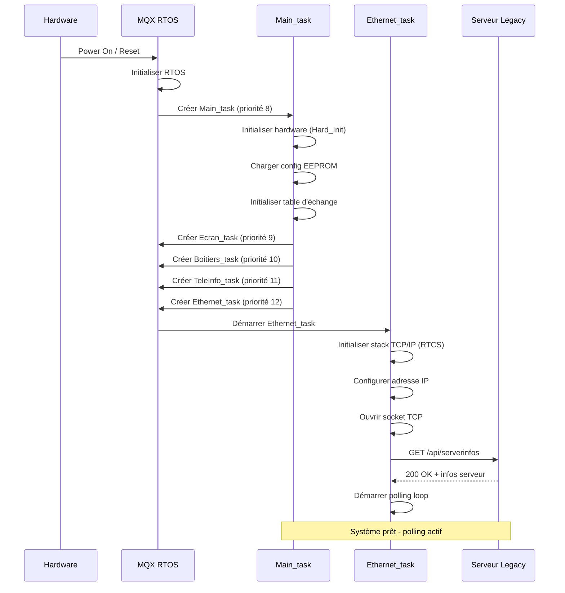
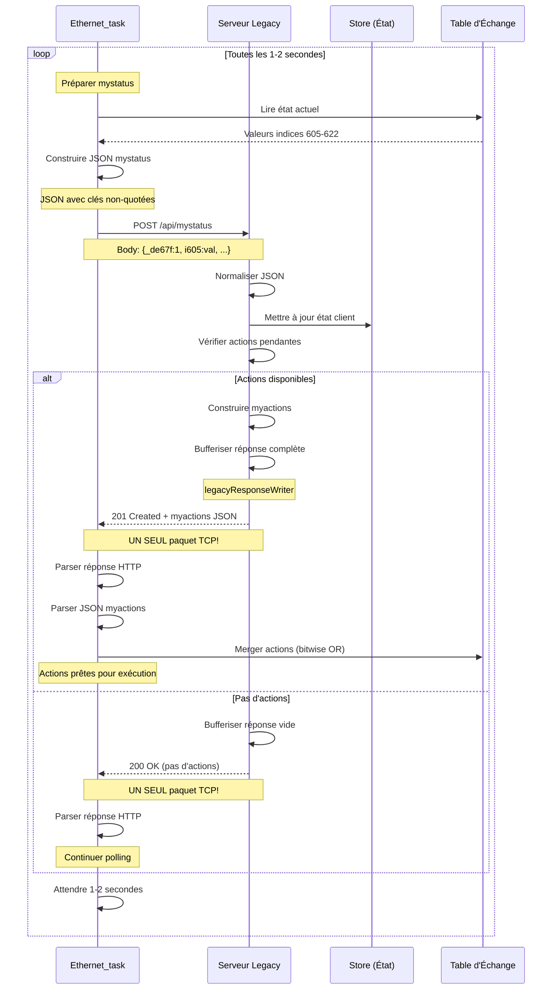
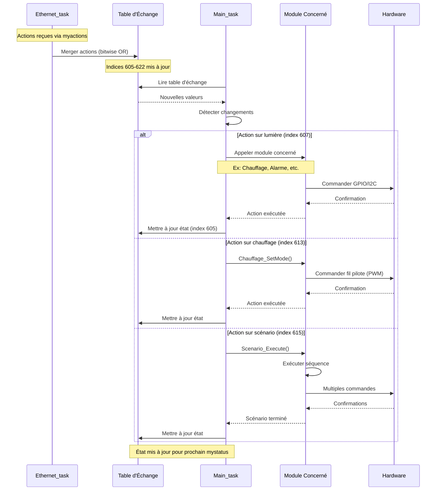
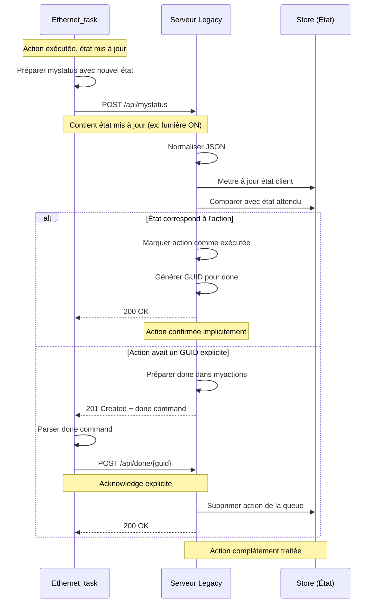
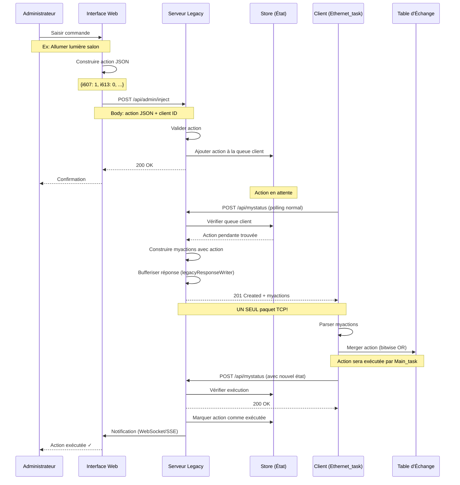

# Diagrammes de Séquence

Ce document présente les diagrammes de séquence pour les principaux flux d'interaction du système client-essensys-legacy. Ces diagrammes illustrent comment le client embarqué, le serveur, et les autres composants communiquent au fil du temps.

## Table des Matières

- [Séquence de Démarrage](#séquence-de-démarrage)
- [Polling mystatus/myactions](#polling-statusmyactions)
- [Exécution d'une Action](#exécution-dune-action)
- [Acknowledgment d'Action](#acknowledgment-daction)
- [Injection de Commande Admin](#injection-de-commande-admin)

---

## Séquence de Démarrage

Ce diagramme montre le processus de démarrage du client embarqué et son initialisation avec le serveur.

### Explication

1. **Power On**: Le microcontrôleur MCF52259 démarre suite à une mise sous tension ou un reset
2. **Initialisation MQX**: Le RTOS MQX s'initialise et configure le scheduler
3. **Main_task**: La tâche principale démarre et initialise le hardware (GPIO, ADC, PWM, timers)
4. **Configuration**: Lecture de la configuration depuis l'EEPROM SPI (adresse MAC, clé serveur)
5. **Création des tâches**: Main_task crée toutes les autres tâches avec leurs priorités respectives
6. **Stack réseau**: Ethernet_task initialise la stack TCP/IP RTCS et configure l'interface réseau
7. **Premier contact**: Le client contacte le serveur via GET /api/serverinfos pour vérifier la connectivité
8. **Polling actif**: Le système entre dans sa boucle principale de polling

**Points critiques:**
- L'ordre de création des tâches est important pour les dépendances
- La stack TCP/IP doit être complètement initialisée avant toute communication
- Le premier appel à /api/serverinfos valide la configuration réseau

---

## Polling mystatus/myactions

Ce diagramme illustre la boucle de polling continue entre le client et le serveur, qui constitue le cœur du protocole de communication.

### Explication

1. **Fréquence**: Le client envoie une requête mystatus toutes les 1-2 secondes
2. **Préparation mystatus**: 
   - Lecture de l'état actuel de la table d'échange (indices 605-622)
   - Construction du JSON avec clés non-quotées (format legacy)
   - Le champ `_de67f` doit toujours être en premier et valoir 1
3. **Envoi au serveur**: POST /api/mystatus avec le JSON malformé
4. **Traitement serveur**:
   - Normalisation du JSON (ajout des quotes aux clés)
   - Mise à jour de l'état du client dans le store
   - Vérification des actions pendantes pour ce client
5. **Réponse avec actions** (201 Created):
   - Le serveur construit le JSON myactions avec toutes les actions
   - **CRITIQUE**: Utilisation du legacyResponseWriter pour bufferiser la réponse complète
   - Envoi en UN SEUL paquet TCP (contrainte hardware du client)
6. **Réponse sans actions** (200 OK):
   - Réponse vide mais toujours en un seul paquet TCP
7. **Traitement client**:
   - Parsing HTTP simple (attend tout en un paquet)
   - Parsing JSON des actions
   - Merge des actions dans la table d'échange avec bitwise OR
8. **Attente**: Délai de 1-2 secondes avant le prochain cycle

**Points critiques:**
- La contrainte single-packet TCP est ESSENTIELLE - sans elle, le client se bloque
- Le merge bitwise OR permet d'accumuler plusieurs commandes
- Le code 201 signale des actions disponibles, 200 signale aucune action
- Le polling continu assure une latence faible pour les commandes

---

## Exécution d'une Action

Ce diagramme montre comment une action reçue du serveur est exécutée par le client embarqué.

### Explication

1. **Réception**: Les actions arrivent via le polling myactions et sont mergées dans la table d'échange
2. **Détection**: Main_task lit périodiquement la table d'échange et détecte les changements
3. **Dispatch**: Selon l'index modifié, Main_task appelle le module approprié:
   - **Index 607**: Contrôle des lumières (via I2C vers boîtiers auxiliaires)
   - **Index 613**: Contrôle du chauffage (fil pilote via PWM)
   - **Index 615**: Exécution de scénarios (séquences d'actions)
   - **Index 590**: Toujours à 1 (validation)
4. **Exécution hardware**: Le module concerné commande le hardware:
   - GPIO pour sorties directes
   - I2C pour boîtiers auxiliaires
   - PWM pour fil pilote
   - ADC pour lectures de capteurs
5. **Mise à jour état**: Une fois l'action exécutée, l'état est mis à jour dans la table d'échange
6. **Feedback**: Le prochain mystatus enverra l'état mis à jour au serveur

**Points critiques:**
- Le merge bitwise OR permet d'accumuler plusieurs commandes sans perte
- Main_task orchestre l'exécution mais délègue aux modules spécialisés
- La mise à jour de l'état dans la table d'échange assure le feedback au serveur
- Les actions peuvent être simples (une lumière) ou complexes (scénario complet)

---

## Acknowledgment d'Action

Ce diagramme montre comment le client acknowledge l'exécution d'une action au serveur.

### Explication

1. **Exécution complète**: Une fois l'action exécutée, l'état du client est mis à jour dans la table d'échange
2. **Mystatus avec nouvel état**: Le prochain mystatus contient l'état mis à jour
3. **Vérification serveur**: Le serveur compare l'état reçu avec l'état attendu après l'action
4. **Acknowledgment implicite**:
   - Si l'état correspond, l'action est considérée comme exécutée
   - Le serveur marque l'action comme complète dans sa queue
   - Pas de communication supplémentaire nécessaire
5. **Acknowledgment explicite** (optionnel):
   - Pour certaines actions critiques, le serveur peut demander un acknowledge explicite
   - Il envoie une commande "done" avec un GUID dans myactions
   - Le client répond avec POST /api/done/{guid}
   - Le serveur supprime définitivement l'action de sa queue
6. **Nettoyage**: L'action est retirée de la queue et ne sera plus renvoyée

**Points critiques:**
- L'acknowledgment implicite via mystatus est le mécanisme principal
- L'acknowledgment explicite via /api/done est utilisé pour les actions critiques
- Le serveur maintient un historique des 25 dernières valeurs pour chaque index
- Si une action n'est pas acknowledgée, elle peut être renvoyée (retry)

---

## Injection de Commande Admin

Ce diagramme montre comment un administrateur peut injecter une commande directement via l'interface web.

### Explication

1. **Saisie admin**: L'administrateur utilise l'interface web pour créer une commande
2. **Construction action**: L'interface web construit le JSON d'action avec les bons indices
3. **Injection**: POST /api/admin/inject envoie l'action au serveur avec l'ID du client cible
4. **Validation**: Le serveur valide l'action (indices corrects, valeurs valides)
5. **Queue**: L'action est ajoutée à la queue des actions pendantes pour ce client
6. **Confirmation web**: L'interface web confirme que l'action a été enregistrée
7. **Polling normal**: Le client continue son polling mystatus normal
8. **Détection action**: Le serveur détecte l'action pendante lors du prochain mystatus
9. **Envoi myactions**: L'action est envoyée au client via myactions (201 Created)
10. **Exécution**: Le client merge l'action et l'exécute normalement
11. **Feedback**: Le mystatus suivant contient l'état mis à jour
12. **Notification**: Le serveur peut notifier l'interface web que l'action a été exécutée

**Points critiques:**
- L'injection admin utilise la même queue que les actions automatiques
- Le délai d'exécution dépend de la fréquence de polling (1-2 secondes)
- L'interface web peut utiliser WebSocket ou SSE pour recevoir les notifications en temps réel
- La validation côté serveur empêche les actions invalides
- Le mécanisme est identique pour les actions automatiques (scénarios, programmations)

---

## Notes Générales

### Contraintes Critiques

Tous ces diagrammes doivent respecter les contraintes suivantes:

1. **Single-Packet TCP**: Toutes les réponses HTTP doivent être envoyées en UN SEUL paquet TCP
2. **JSON malformé**: Le client envoie du JSON avec clés non-quotées, le serveur doit normaliser
3. **Headers HTTP**: Format exact requis, notamment `Content-Type: application/json; charset=utf-8` (avec espace)
4. **Polling continu**: Le client poll toutes les 1-2 secondes, c'est le cœur du protocole
5. **Bitwise OR merge**: Les actions sont mergées avec OR, pas écrasées
6. **Champ _de67f**: Doit toujours être en premier dans le JSON et valoir 1

### Outils de Diagnostic

Pour observer ces séquences en pratique:

- **tcpdump**: Capturer les paquets TCP et vérifier le single-packet
- **Wireshark**: Analyser les séquences complètes avec timeline
- **Logs serveur**: Tracer les requêtes mystatus/myactions
- **Debug UART**: Observer les logs du client embarqué

### Références

- [Protocole HTTP Legacy](../protocol/http-legacy-protocol.md)
- [Contrainte TCP Single-Packet](../protocol/tcp-single-packet.md)
- [Table d'Échange](../protocol/exchange-table.md)
- [Architecture Client](../embedded-client/architecture.md)
- [API Endpoints](../server/api-endpoints.md)
