# Vue d'Ensemble du Système

## Introduction

Ce document présente une vue d'ensemble complète du système client-essensys-legacy, montrant l'architecture globale et les interactions entre tous les composants principaux.

## Diagramme d'Architecture Système

Le diagramme ci-dessous illustre l'architecture complète du système, incluant le client embarqué, le serveur, l'interface web, et les composants externes.

```mermaid
graph TB
    subgraph "Client Embarqué BP_MQX_ETH"
        subgraph "MQX RTOS Tasks"
            MainTask[Main_task<br/>Priorité: 8<br/>Gestion principale]
            EcranTask[Ecran_task<br/>Priorité: 9<br/>Interface utilisateur]
            BoitiersTask[Boitiers_task<br/>Priorité: 10<br/>Communication I2C]
            TeleInfoTask[TeleInfo_task<br/>Priorité: 11<br/>Compteur Linky]
            EthernetTask[Ethernet_task<br/>Priorité: 12<br/>Communication réseau]
        end
        
        subgraph "Modules C"
            TableEchange[Table d'Échange<br/>Indices 605-622]
            Alarme[Module Alarme]
            Chauffage[Module Chauffage<br/>Fil Pilote]
            Scenario[Module Scénario]
            Json[Parser JSON]
            Cryptage[Module Cryptage]
        end
        
        subgraph "Communications"
            I2C[Bus I2C]
            SPI[Bus SPI]
            UART[UART]
            TCP[Stack TCP/IP RTCS]
        end
        
        subgraph "Hardware MCF52259"
            GPIO[GPIO<br/>Entrées/Sorties]
            ADC[ADC<br/>Détection fuites]
            PWM[PWM<br/>Fil Pilote]
        end
    end
    
    subgraph "Composants Externes"
        Linky[Compteur Linky<br/>TeleInfo]
        I2CBoxes[Boîtiers Auxiliaires<br/>I2C]
        EEPROM[EEPROM SPI<br/>MAC + Clé]
        Sensors[Capteurs<br/>Température, Fuites]
    end
    
    subgraph "Serveur Go"
        HTTPServer[Serveur HTTP<br/>legacyResponseWriter]
        Store[Store<br/>État du système]
        Services[Services Layer]
        AdminAPI[Admin API]
    end
    
    subgraph "Interface Web"
        WebUI[Interface Web<br/>Dashboard]
        WebAdmin[Interface Admin]
    end
    
    %% Connexions Client Embarqué - Hardware
    MainTask --> TableEchange
    MainTask --> Alarme
    MainTask --> Chauffage
    MainTask --> Scenario
    EcranTask --> GPIO
    BoitiersTask --> I2C
    TeleInfoTask --> UART
    EthernetTask --> TCP
    EthernetTask --> Json
    EthernetTask --> Cryptage
    EthernetTask --> TableEchange
    Chauffage --> PWM
    Alarme --> GPIO
    Alarme --> ADC
    
    %% Connexions Communications - Composants Externes
    I2C <-->|Protocole I2C| I2CBoxes
    SPI <-->|Lecture/Écriture| EEPROM
    UART <-->|Trames TeleInfo| Linky
    GPIO <-->|Signaux| Sensors
    
    %% Connexions Réseau
    TCP <-->|HTTP Legacy<br/>Single-Packet TCP| HTTPServer
    
    %% Connexions Serveur
    HTTPServer --> Store
    HTTPServer --> Services
    Services --> Store
    AdminAPI --> Services
    
    %% Connexions Interface Web
    WebUI <-->|API REST| HTTPServer
    WebAdmin <-->|Admin API| AdminAPI
    
    %% Flux de données principaux
    TableEchange -.->|POST /api/mystatus<br/>État système| HTTPServer
    HTTPServer -.->|GET /api/myactions<br/>Commandes| TableEchange
    
    style MainTask fill:#e1f5ff
    style EthernetTask fill:#e1f5ff
    style TableEchange fill:#fff4e1
    style HTTPServer fill:#e8f5e9
    style Linky fill:#fce4ec
    style I2CBoxes fill:#fce4ec
```



## Description des Composants

### Client Embarqué (BP_MQX_ETH)

Le client embarqué est basé sur un microcontrôleur **MCF52259 Coldfire** exécutant le système d'exploitation temps réel **MQX RTOS**. Il gère toutes les fonctions domotiques locales.

#### Tâches MQX

- **Main_task**: Tâche principale qui coordonne les modules (Alarme, Chauffage, Scénarios)
- **Ecran_task**: Gère l'interface utilisateur locale (écran et boutons)
- **Boitiers_task**: Communique avec les boîtiers auxiliaires via I2C
- **TeleInfo_task**: Lit les données du compteur Linky via UART
- **Ethernet_task**: Gère la communication réseau avec le serveur (polling, actions)

#### Modules Principaux

- **Table d'Échange**: Structure de données centrale (indices 605-622) partagée entre client et serveur
- **Module Alarme**: Gestion des alarmes (intrusion, fuites, etc.)
- **Module Chauffage**: Contrôle du chauffage via fil pilote français
- **Module Scénario**: Automatisations programmables
- **Parser JSON**: Parse le JSON malformé du protocole legacy
- **Module Cryptage**: Sécurisation des communications

#### Communications

- **I2C**: Communication avec les boîtiers auxiliaires (extension du système)
- **SPI**: Lecture de l'EEPROM (adresse MAC, clé serveur)
- **UART**: Réception des trames TeleInfo du compteur Linky
- **TCP/IP**: Stack RTCS pour la communication Ethernet avec le serveur

### Composants Externes

#### Compteur Linky
Compteur électrique intelligent français qui envoie des données de consommation via le protocole TeleInfo (UART).

#### Boîtiers Auxiliaires I2C
Modules d'extension connectés via bus I2C pour ajouter des entrées/sorties supplémentaires au système.

#### EEPROM SPI
Mémoire non-volatile contenant l'adresse MAC et la clé de sécurité du serveur.

#### Capteurs
Capteurs de température, détecteurs de fuites d'eau, etc., connectés aux GPIO et ADC.

### Serveur Go

Le serveur implémente le protocole HTTP legacy avec ses contraintes spécifiques.

#### Composants Serveur

- **Serveur HTTP**: Implémente le `legacyResponseWriter` pour respecter la contrainte single-packet TCP
- **Store**: Maintient l'état du système (table d'échange, actions en attente)
- **Services Layer**: Logique métier (gestion des actions, historique)
- **Admin API**: Interface d'administration pour injection de commandes

### Interface Web

- **Dashboard**: Interface utilisateur pour visualiser l'état et contrôler le système
- **Interface Admin**: Outils d'administration et de diagnostic

## Flux de Données Principaux

### 1. Polling État Système (mystatus)

```
Client → POST /api/mystatus → Serveur
  - Envoie l'état complet de la table d'échange
  - JSON malformé (clés non-quotées)
  - Réponse en un seul paquet TCP
```

### 2. Récupération Actions (myactions)

```
Serveur → GET /api/myactions → Client
  - Retourne les actions à exécuter
  - Table d'échange complète (indices 605-622)
  - Champ _de67f en premier
  - Réponse en un seul paquet TCP
```

### 3. Acknowledge Action (done)

```
Client → POST /api/done/{guid} → Serveur
  - Confirme l'exécution d'une action
  - Permet au serveur de retirer l'action de la queue
```

### 4. Injection Admin

```
Interface Admin → POST /api/admin/inject → Serveur → Client
  - Permet d'injecter des commandes directement
  - Utilisé pour le contrôle manuel et les tests
```

### 5. Données TeleInfo

```
Compteur Linky → UART → TeleInfo_task → Table d'Échange → Serveur
  - Flux continu de données de consommation électrique
  - Parsing des trames TeleInfo
  - Mise à jour de la table d'échange
```

### 6. Communication I2C

```
Boîtiers Auxiliaires ↔ I2C ↔ Boitiers_task ↔ Table d'Échange
  - Lecture des états des boîtiers
  - Envoi de commandes aux boîtiers
  - Synchronisation bidirectionnelle
```

## Légende

### Couleurs

- **Bleu clair** (`#e1f5ff`): Tâches MQX critiques pour la communication
- **Jaune clair** (`#fff4e1`): Table d'échange (composant central)
- **Vert clair** (`#e8f5e9`): Serveur HTTP
- **Rose clair** (`#fce4ec`): Composants externes

### Types de Connexions

- **Flèches pleines** (`-->`) : Dépendances et appels de fonctions internes
- **Flèches doubles** (`<-->`) : Communication bidirectionnelle
- **Flèches pointillées** (`-.->`) : Communication réseau HTTP

### Symboles

- **Sous-graphes** : Regroupements logiques de composants
- **Rectangles** : Composants individuels
- **Texte `<br/>`** : Informations supplémentaires (priorités, descriptions)

## Contraintes Critiques

### Single-Packet TCP Requirement

⚠️ **CRITIQUE**: Toutes les réponses HTTP du serveur doivent être envoyées en **un seul paquet TCP**.

Le parser HTTP du client embarqué est simple et ne peut pas gérer les réponses fragmentées. Si la réponse arrive en plusieurs paquets, le client se bloque.

**Solution**: Le serveur utilise un `legacyResponseWriter` qui bufferise toute la réponse avant de l'envoyer.

Voir [tcp-single-packet.md](../protocol/tcp-single-packet.md) pour plus de détails.

### JSON Malformé

Le client envoie du JSON avec des clés non-quotées (non-standard). Le serveur doit normaliser ce JSON avant de le parser.

Voir [http-legacy-protocol.md](../protocol/http-legacy-protocol.md) pour plus de détails.

### Table d'Échange Complète

Lors de l'envoi d'actions via `/api/myactions`, le serveur doit **toujours** envoyer la table d'échange complète (indices 605-622), même si une seule valeur change.

Voir [exchange-table.md](../protocol/exchange-table.md) pour plus de détails.

## Fréquence de Communication

- **Polling mystatus/myactions**: 1-2 secondes
- **Lecture TeleInfo**: Continue (trames toutes les ~1 seconde)
- **Scan I2C**: Périodique (configurable, typiquement 5-10 secondes)
- **Mise à jour écran**: En réponse aux événements

## Références

- [Architecture Client Embarqué](../embedded-client/architecture.md)
- [Protocole HTTP Legacy](../protocol/http-legacy-protocol.md)
- [Implémentation Serveur Go](../server/go-implementation.md)
- [Communications Client](../embedded-client/communications.md)
