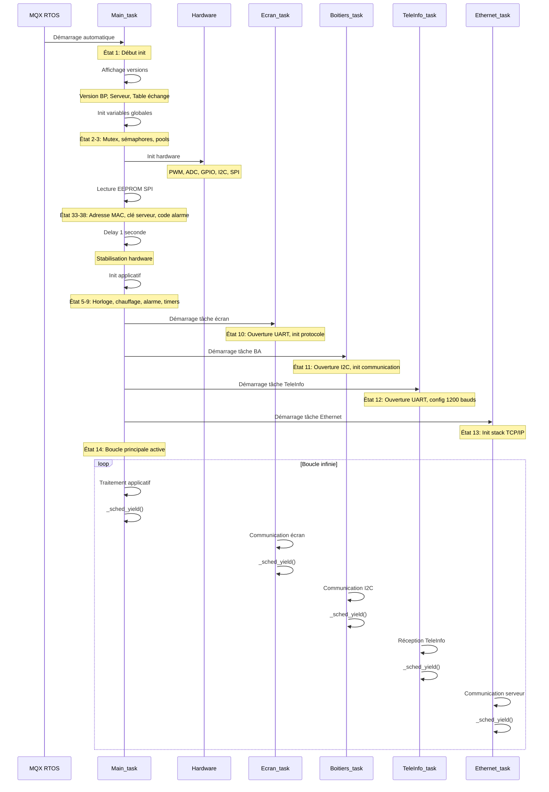

# Architecture du Client Embarqué

## Vue d'ensemble

Le client embarqué BP_MQX_ETH est un système domotique temps réel basé sur le système d'exploitation MQX RTOS de Freescale. Il s'exécute sur un microcontrôleur Coldfire MCF52259 et gère l'ensemble des fonctions domotiques : chauffage, alarme, éclairage, volets, communication avec les boîtiers auxiliaires, et interface avec le compteur Linky.

## Microcontrôleur MCF52259

### Caractéristiques principales

- **Processeur** : Coldfire V2 MCF52259
- **Architecture** : 32 bits RISC
- **Fréquence** : Configurable (typiquement 80 MHz)
- **Mémoire Flash** : Interne pour le programme
- **RAM** : Interne + possibilité d'extension MRAM externe
- **Périphériques intégrés** :
  - Contrôleur I2C (pour communication avec boîtiers auxiliaires)
  - Contrôleurs UART (pour écran, TeleInfo, debug)
  - Contrôleur SPI (pour EEPROM externe)
  - ADC (pour détection fuites d'eau)
  - Timers et PWM (pour fil pilote chauffage)
  - GPIO (entrées/sorties numériques)
  - Contrôleur Ethernet MAC

## MQX RTOS

### Présentation

MQX (Message Queue eXecutive) est un système d'exploitation temps réel préemptif développé par Freescale (maintenant NXP). Il fournit :

- **Ordonnancement préemptif** : Les tâches de priorité supérieure interrompent les tâches de priorité inférieure
- **Time slicing** : Partage du temps CPU entre tâches de même priorité
- **Synchronisation** : Mutex, sémaphores, files de messages
- **Gestion mémoire** : Allocation dynamique avec pools de messages
- **Timers** : Timers périodiques et one-shot
- **Résolution temporelle** : Configurable (typiquement quelques millisecondes)

### Configuration système

```c
// Résolution du système d'exploitation
OS RESOLUTION : X ms  // Affiché au démarrage
```

## Tâches MQX

Le système est organisé en 5 tâches principales qui s'exécutent en parallèle. Toutes les tâches ont la même priorité (8) et utilisent le time slicing pour partager le CPU.

### Configuration des tâches

```c
TASK_TEMPLATE_STRUCT MQX_template_list[] =
{
/*  Task number, Entry point,      Stack, Pri, String,    Auto?                */
   {MAIN_TASK,   Main_task,         1596,  8,   "Main",    MQX_AUTO_START_TASK},
   {ECRAN_TASK,  vd_Ecran_task,     1500,  8,   "Ecran",   MQX_TIME_SLICE_TASK, 50},
   {BA_TASK,     Boitiers_task,     1796,  8,   "I2C",     MQX_TIME_SLICE_TASK, 50},
   {TELE_TASK,   TeleInfo_task,     1396,  8,   "TeleInf", MQX_TIME_SLICE_TASK, 30},
   {ETH_TASK,    Ethernet_task,     3000,  8,   "Ethernet",MQX_TIME_SLICE_TASK, 50},
   {0,           0,                  0,     0,   0,         0,                      }
};
```

### 1. Main_task (Tâche Principale)

**Responsabilités** :
- Initialisation complète du système au démarrage
- Gestion de la date et de l'heure (RTC)
- Traitement du chauffage (fil pilote, zones, plannings)
- Gestion de l'alarme (détection, sirènes, procédures)
- Gestion des scénarios (je sors, je rentre, vacances, etc.)
- Détection des fuites d'eau (ADC)
- Gestion de l'arrosage
- Gestion de l'anémomètre
- Surveillance des alimentations et batterie
- Délestage en cas de surconsommation
- Mise à jour de la table d'échange
- Pilotage des sorties locales du BP

**Stack** : 1596 octets  
**Priorité** : 8  
**Mode** : Auto-start (démarre automatiquement avec MQX)  
**Time slice** : Non (tâche principale toujours active)

**Cycle de traitement** :
```
Boucle infinie :
  - Mise à jour date/heure (RTC)
  - Traitement toutes les 50ms : acquisition ADC, vérification batterie
  - Traitement chaque seconde : 
    * Surveillance alimentations
    * Gestion fil pilote
    * Gestion anémomètre
    * Compteurs divers
  - Traitement chaque minute :
    * Réveil (ouverture volets)
    * Retour de vacances
    * Recalcul chauffage
  - Traitement continu :
    * Alarme
    * Détection fuites
    * Scénarios
    * Pilotage sorties
    * Mise à jour table d'échange
  - Espion RS (debug)
  - _sched_yield() : passe la main aux autres tâches
```

### 2. Ecran_task (Interface Utilisateur)

**Responsabilités** :
- Communication série avec l'écran tactile
- Réception des commandes utilisateur
- Envoi du statut système (date, température, alarme, etc.)
- Gestion du protocole propriétaire de l'écran
- Lecture/écriture de la table d'échange depuis l'écran
- Détection timeout communication écran

**Stack** : 1500 octets  
**Priorité** : 8  
**Mode** : Time slice (50 ms)  
**Port série** : UART configuré en mode non-bloquant

**Protocole** :
- Trame de synchronisation (0x0F) au démarrage
- Trame de statut (0xF0) envoyée périodiquement
- Lecture données discrètes (0x55)
- Écriture données discrètes (0x5A)
- Lecture bloc de données (0xA5)
- Écriture bloc de données (0xAA)
- Checksum XOR sur toutes les trames

**Cycle de traitement** :
```
Boucle infinie :
  - Lecture buffer réception UART
  - Analyse des trames reçues
  - Traitement selon type de trame
  - Envoi réponse appropriée
  - Gestion timeout (détection déconnexion écran)
  - _sched_yield()
```

### 3. Boitiers_task (Communication I2C)

**Responsabilités** :
- Communication I2C avec les 3 boîtiers auxiliaires (BA)
- Envoi des configurations (sorties, temporisations)
- Envoi des actions (allumage/extinction lumières, volets)
- Envoi des ordres de forçage (scénarios)
- Gestion des acquittements et répétitions
- Détection des défauts de communication
- Sauvegarde état BA en mode secouru

**Stack** : 1796 octets  
**Priorité** : 8  
**Mode** : Time slice (50 ms)  
**Bus I2C** : Mode maître, 50 kHz

**Boîtiers auxiliaires** :
- BA 0 : Pièces de vie (PDV)
- BA 1 : Chambres (CHB)
- BA 2 : Pièces d'eau (PDE)

**Types de trames I2C** :
- Configuration des sorties (0x01)
- Temps d'extinction (0x02)
- Temps d'action volets (0x03)
- Actions (secouru, blocage volets, forçage allumage) (0x04)
- Forçage sorties (0x05)

**Cycle de traitement** :
```
Boucle infinie :
  - Envoi actions (secouru, blocage, forçage)
  - Traitement messages de forçage (depuis Main_task)
  - Envoi configurations sorties (si modifiées)
  - Envoi temps d'extinction (si modifiés)
  - Envoi temps d'action volets (si modifiés)
  - Gestion répétitions en cas d'erreur
  - Surveillance communication (détection défauts)
  - _sched_yield()
```

### 4. TeleInfo_task (Compteur Linky)

**Responsabilités** :
- Réception des trames du compteur Linky (TeleInfo)
- Décodage du protocole TeleInfo ERDF
- Extraction des informations (puissance, index, tarif)
- Gestion du délestage (ADPS)
- Calcul de la répartition de consommation
- Pilotage LED TeleInfo (fixe si OK, clignotante si défaut)
- Détection timeout communication

**Stack** : 1396 octets  
**Priorité** : 8  
**Mode** : Time slice (30 ms)  
**Port série** : UART 1200 bauds, 7 bits, parité paire

**Informations extraites** :
- OPTARIF : Option tarifaire (BASE, HC, EJP, BBR)
- PTEC : Période tarifaire en cours (HC, HP, etc.)
- PAPP : Puissance apparente (VA)
- HCHC : Index heures creuses (Wh)
- HCHP : Index heures pleines (Wh)
- BASE : Index base (Wh)
- ADPS : Avertissement dépassement puissance souscrite

**Cycle de traitement** :
```
Boucle infinie :
  - Lecture buffer réception UART
  - Recherche début/fin groupe information (0x0A / 0x0D)
  - Vérification checksum
  - Extraction étiquette et données
  - Mise à jour table d'échange
  - Gestion délestage (si ADPS reçu)
  - Calcul répartition consommation
  - Gestion timeouts
  - _sched_yield()
```

### 5. Ethernet_task (Réseau)

**Responsabilités** :
- Initialisation stack TCP/IP (RTCS)
- Configuration réseau (DHCP ou IP fixe)
- Résolution DNS du serveur
- Connexion au serveur legacy
- Envoi trames de statut (mystatus)
- Réception actions du serveur (myactions)
- Acquittement actions (done)
- Gestion du téléchargement firmware (download)
- Surveillance état réseau (câble, DHCP, DNS, serveur)

**Stack** : 3000 octets (le plus important, nécessaire pour stack TCP/IP)  
**Priorité** : 8  
**Mode** : Time slice (50 ms)  
**Protocole** : HTTP non-standard avec contrainte single-packet

**Cycle de traitement** :
```
Boucle infinie :
  - Vérification présence câble Ethernet
  - Configuration DHCP si nécessaire
  - Résolution DNS du serveur
  - Ouverture socket vers serveur
  - Envoi trame mystatus (état système)
  - Réception trame myactions (commandes)
  - Traitement actions reçues
  - Envoi acquittement done
  - Gestion téléchargement firmware
  - Fermeture socket
  - Attente avant prochain cycle (1-2 secondes)
  - _sched_yield()
```

## Primitives de Synchronisation

### Mutex

Les mutex protègent l'accès concurrent aux ressources partagées entre tâches :

```c
// Mutex pour les zones de chauffage
MUTEX_STRUCT st_Mutex_ZJ;      // Zone jour
MUTEX_STRUCT st_Mutex_ZN;      // Zone nuit
MUTEX_STRUCT st_Mutex_Zsdb1;   // Salle de bain 1
MUTEX_STRUCT st_Mutex_Zsdb2;   // Salle de bain 2

// Mutex pour la date/heure partagée avec l'écran
MUTEX_STRUCT st_Mutex_DateHeurePourEcran;
```

**Utilisation** :
```c
_mutex_lock(&st_Mutex_ZJ);
// Accès à la ressource protégée
_mutex_unlock(&st_Mutex_ZJ);
```

### Sémaphores légers (Lightweight Semaphores)

Les sémaphores légers sont utilisés pour la signalisation entre tâches :

```c
// Sémaphore pour mise à jour date/heure
LWSEM_STRUCT lwsem_wr_date;

// Sémaphore pour protection accès RS écran
LWSEM_STRUCT st_LW_lock_screen;

// Sémaphore pour protection bus I2C
LWSEM_STRUCT lock_I2C;
```

**Utilisation** :
```c
_lwsem_wait(&lock_I2C);
// Transaction I2C
_lwsem_post(&lock_I2C);
```

### Files de messages (Message Queues)

Les files de messages permettent la communication asynchrone entre tâches :

```c
// Pool de messages pour communication Main -> BA
_pool_id message_pool;

// Queue pour réception messages dans BA_task
_queue_id BA_qid;
```

**Utilisation** :
```c
// Envoi (depuis Main_task)
msg_ptr = _msg_alloc(message_pool);
msg_ptr->DATA[0] = numero_boitier;
// ... remplir données
_msgq_send(msg_ptr);

// Réception (dans Boitiers_task)
msg_ptr = _msgq_poll(BA_qid);
if (msg_ptr != NULL) {
    // Traiter message
    _msg_free(msg_ptr);
}
```

### Timers

Les timers MQX permettent l'exécution périodique de fonctions :

```c
// Timer 50ms pour cadencer les traitements
_timer_start_periodic_at_ticks(vd_Timer50ms_Traitement, ...);

// Timer 1 seconde pour compteurs
_timer_start_periodic_at_ticks(vd_Timer1sec_Traitement, ...);

// Timer timeout écran
_timer_start_periodic_every_ticks(vd_EcranTimeOUT, ...);

// Timer timeout TeleInfo
_timer_start_periodic_every_ticks(vd_TeleinfoTimer, ...);
```

## Séquence de Démarrage du Système



## Gestion de la Mémoire

### Stack des tâches

Chaque tâche possède sa propre pile (stack) allouée statiquement :

- **Main_task** : 1596 octets
- **Ecran_task** : 1500 octets
- **Boitiers_task** : 1796 octets
- **TeleInfo_task** : 1396 octets
- **Ethernet_task** : 3000 octets (nécessite plus pour stack TCP/IP)

**Total stack** : ~9288 octets

### Heap

Le système utilise l'allocation dynamique MQX pour :
- Pools de messages
- Buffers temporaires
- Stack TCP/IP

**Surveillance** :
```c
_mem_get_highwater();  // Pic d'utilisation mémoire
_klog_show_stack_usage();  // Utilisation stack par tâche
```

### Mémoire externe

- **EEPROM SPI** : Stockage adresse MAC, clé serveur, code alarme
- **Flash interne** : Sauvegarde table d'échange
- **MRAM externe** (optionnel) : Extension mémoire

## Gestion des Erreurs

Chaque tâche possède un système de détection d'erreurs :

```c
// Variables d'état par tâche
unsigned char uc_EspionTachePrincipaleEtat;
unsigned char uc_EspionTacheEcranEtat;
unsigned char uc_EspionTacheBAEtat;
unsigned char uc_EspionTacheTeleinfoEtat;
unsigned char uc_EspionTacheEthernetEtat;

// Codes d'erreur par tâche
unsigned short us_ErreursTachePrincipale;
unsigned short us_ErreursTacheEcran;
unsigned short us_ErreursTacheBA;
unsigned short us_ErreursAlarme;
unsigned short us_ErreursRTC;
```

Les erreurs sont signalées via des macros `DETECTION_ERREUR_xxx` et peuvent être consultées via l'espion RS (debug série).

## Performance et Temps Réel

### Résolution temporelle

Le système MQX fonctionne avec une résolution configurable (typiquement quelques millisecondes), affichée au démarrage.

### Time slicing

Les tâches de même priorité (8) se partagent le CPU selon leur quantum de temps :
- Ecran, BA, Ethernet : 50 ms
- TeleInfo : 30 ms

### Latence

Les traitements critiques (alarme, détection fuites) sont gérés dans Main_task qui s'exécute en continu avec `_sched_yield()` pour partager le CPU.

### Watchdog

Le système surveille l'activité des tâches via des compteurs d'activité et des états pour détecter les blocages.

## Considérations de Développement

### Contraintes mémoire

Le MCF52259 a des ressources limitées :
- Optimiser l'utilisation de la stack
- Limiter l'allocation dynamique
- Réutiliser les buffers quand possible

### Débogage

Le système inclut un module "EspionRS" pour le debug via UART :
- Traces d'activité par tâche
- Compteurs d'événements
- États des tâches
- Erreurs détectées

### Modifications

Lors de modifications du code :
- Vérifier l'utilisation stack avec `_klog_show_stack_usage()`
- Tester les cas de charge maximale
- Valider la synchronisation entre tâches
- Vérifier les timeouts et répétitions
