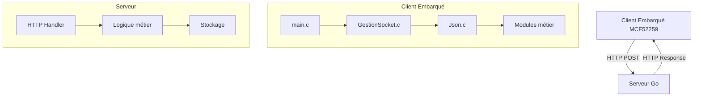

# Client Embarqué BP_MQX_ETH

Bienvenue dans la documentation du système de contrôle domotique embarqué basé sur MQX RTOS pour microcontrôleur Freescale MCF52259.

## Vue d'ensemble

Ce projet implémente un client embarqué pour un système de contrôle domotique qui communique avec un serveur via Ethernet. Le système gère divers aspects de l'automatisation domestique incluant le chauffage, l'éclairage, les alarmes, et plus encore.

### Caractéristiques principales

- **Plateforme**: Freescale MCF52259 (ColdFire V2)
- **RTOS**: MQX 3.8
- **Connectivité**: Ethernet 10/100 Mbps
- **Protocole**: HTTP avec format JSON personnalisé
- **Modules**: Chauffage, Alarme, Scénarios, TeleInfo, Arrosage, etc.

## Navigation rapide

### 📡 Protocole de communication

Découvrez le protocole HTTP legacy et ses contraintes spécifiques:

- [Protocole HTTP Legacy](protocol/http-legacy-protocol.md) - Format de communication client-serveur
- [Contrainte TCP Single-Packet](protocol/tcp-single-packet.md) - Exigence critique du client
- [Table d'échange](protocol/exchange-table.md) - Structure des données échangées

### 💻 Client embarqué

Explorez l'architecture et les modules du firmware:

- [Architecture](embedded-client/architecture.md) - Structure globale du système
- [Référence des modules](embedded-client/modules-reference.md) - Documentation détaillée des modules
- [Communications](embedded-client/communications.md) - Gestion réseau et protocoles
- [Matériel](embedded-client/hardware.md) - Configuration matérielle

### 🖥️ Serveur

Implémentation côté serveur:

- [Implémentation Go](server/go-implementation.md) - Architecture du serveur
- [Points d'API](server/api-endpoints.md) - Endpoints disponibles

### 📊 Diagrammes

Visualisez le système:

- [Vue d'ensemble](diagrams/system-overview.md) - Architecture globale
- [Séquences](diagrams/sequence-diagrams.md) - Flux d'interactions
- [Flux de données](diagrams/data-flow.md) - Circulation des données

### 🔧 Dépannage

- [Débogage réseau](troubleshooting/network-debugging.md) - Résolution des problèmes courants

## Démarrage rapide

### Prérequis

- CodeWarrior Development Studio 10.x
- MQX 3.8 RTOS
- Carte de développement MCF52259EVB ou compatible
- Connexion Ethernet

### Compilation

1. Ouvrir le projet dans CodeWarrior
2. Sélectionner la configuration de build appropriée:
   - `m52259evb_Int_Flash_Debug` - Debug en Flash interne
   - `m52259evb_Int_Flash_Release` - Release en Flash interne
   - `m52259evb_Ext_MRAM_Debug` - Debug en MRAM externe
3. Compiler le projet (Project → Build)

### Configuration réseau

Le client nécessite une configuration réseau appropriée:

```c
// Configuration dans Hard.c
#define IP_ADDRESS      "192.168.1.100"
#define SUBNET_MASK     "255.255.255.0"
#define GATEWAY         "192.168.1.1"
```

## Contraintes importantes

!!! warning "Contraintes critiques"
    - **Single-Packet TCP**: Le client nécessite que toute la réponse HTTP soit dans un seul paquet TCP
    - **JSON malformé**: Le client envoie du JSON avec des clés non quotées
    - **En-têtes HTTP**: Format spécifique avec espace avant `;charset`
    - **Table d'échange complète**: Tous les indices 605-622 doivent être présents

## Architecture système



## Licence

Ce projet est sous licence MIT. Voir le fichier [LICENSE](https://github.com/VOTRE_USERNAME/VOTRE_REPO/blob/main/LICENSE) pour plus de détails.

## Contribution

Les contributions sont les bienvenues! N'hésitez pas à ouvrir une issue ou une pull request.

## Support

Pour toute question ou problème, consultez la section [Dépannage](troubleshooting/network-debugging.md) ou ouvrez une issue sur GitHub.
