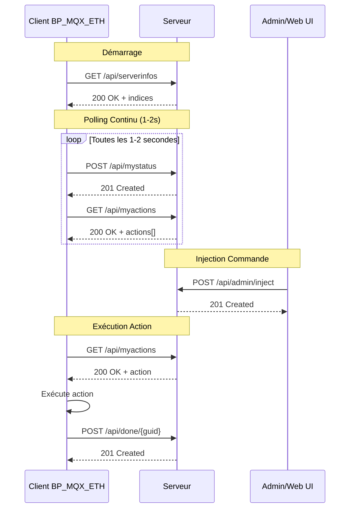
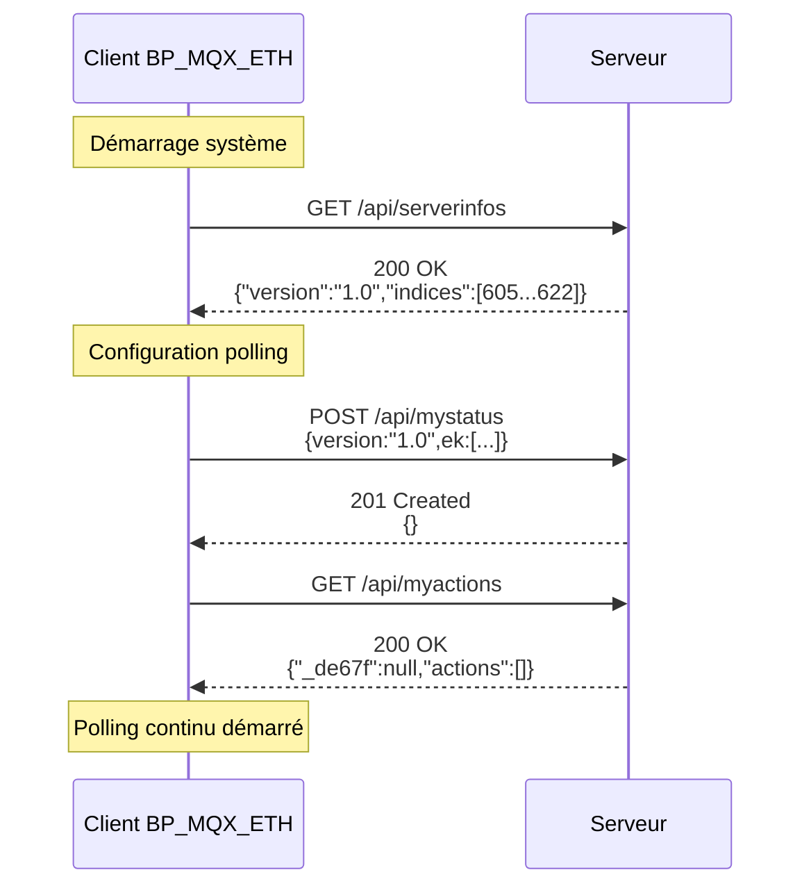
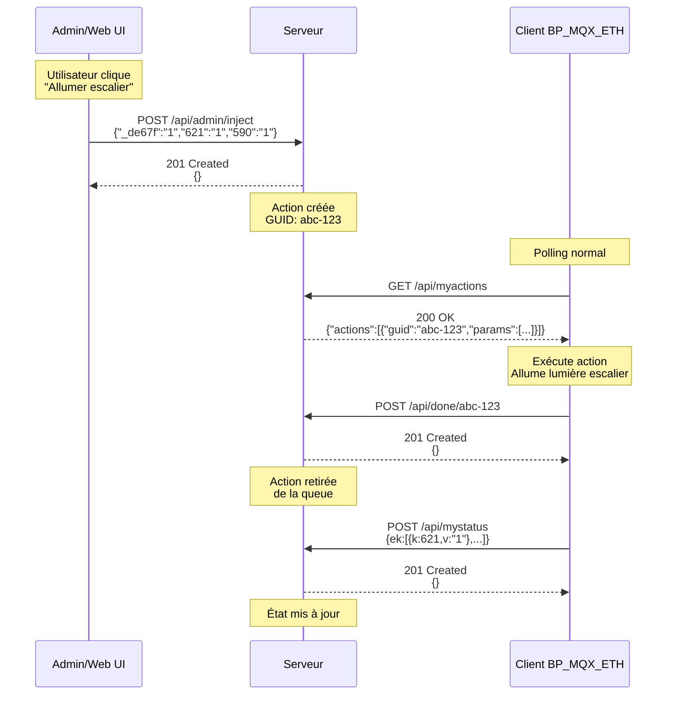
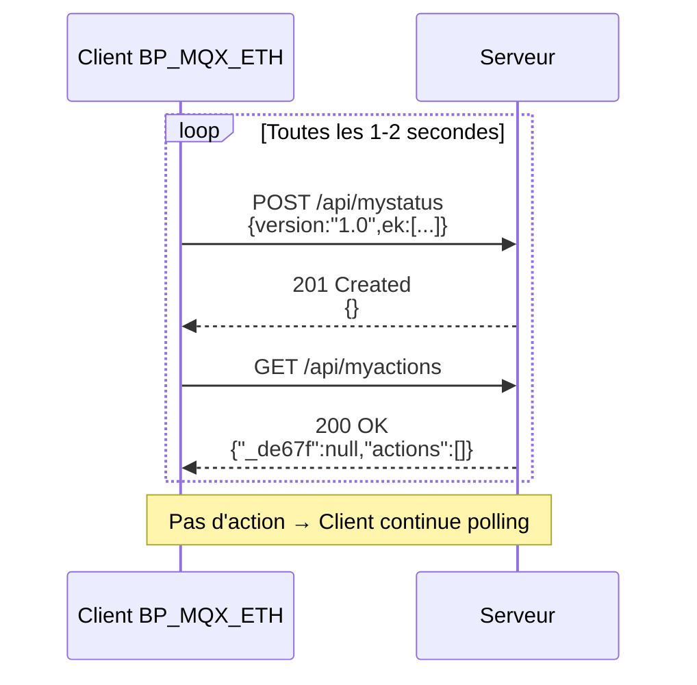
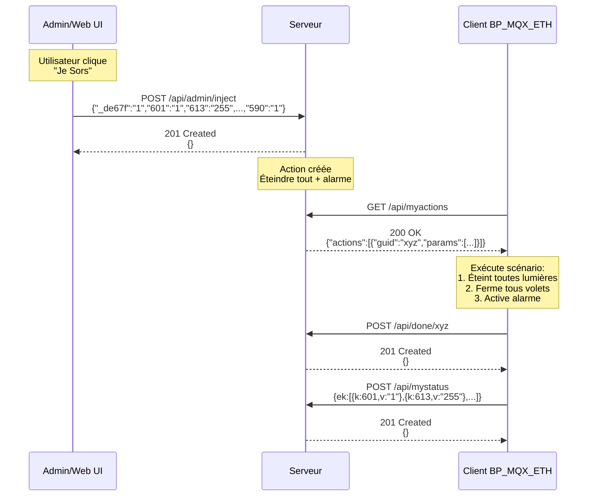
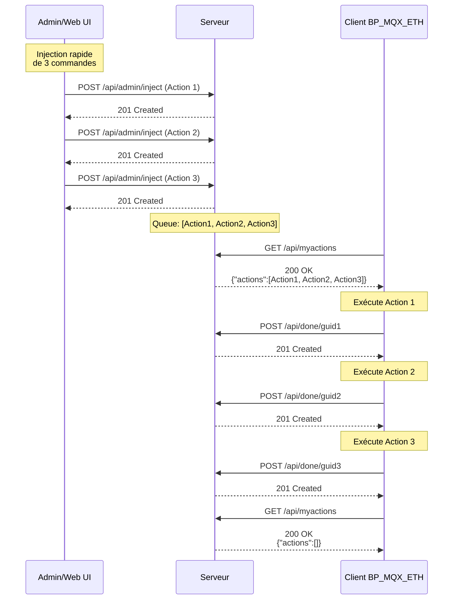
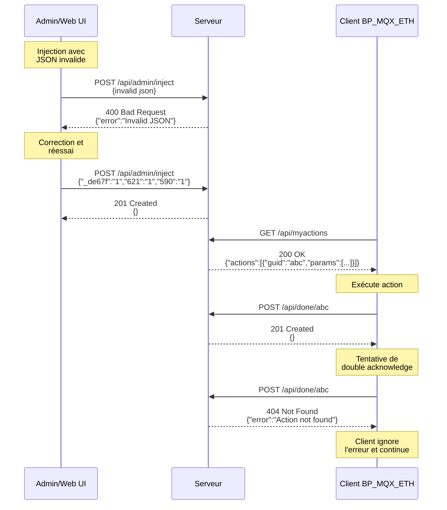
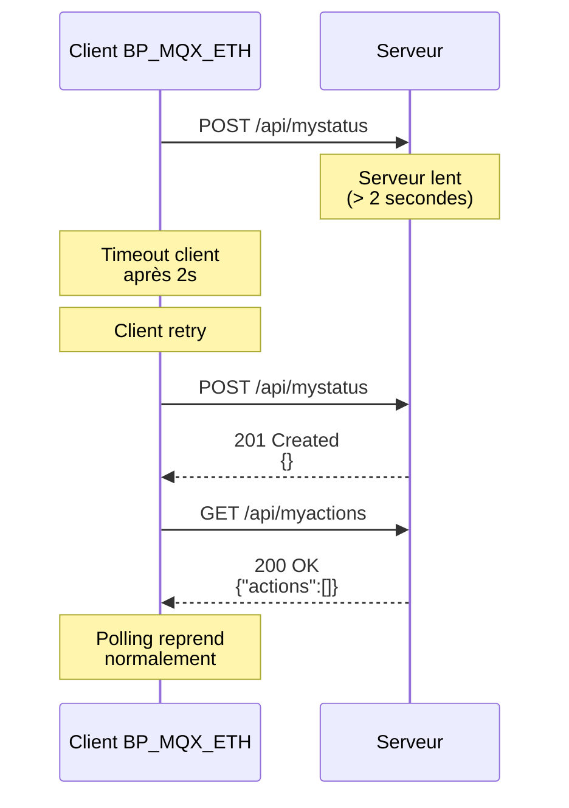

# API Endpoints - Documentation Complète

## Table des Matières

- [Vue d'Ensemble](#vue-densemble)
- [Polling et Fréquence](#polling-et-fréquence)
- [GET /api/serverinfos](#get-apiserverinfos)
- [POST /api/mystatus](#post-apimystatus)
- [GET /api/myactions](#get-apimyactions)
- [POST /api/done/{guid}](#post-apidoneguid)
- [POST /api/admin/inject](#post-apiadmininject)
- [Codes d'Erreur](#codes-derreur)
- [Exemples de Séquences](#exemples-de-séquences)
- [Références](#références)

## Vue d'Ensemble

L'API du serveur legacy expose 5 endpoints principaux pour la communication avec le client embarqué BP_MQX_ETH. Ces endpoints implémentent un protocole de polling où le client interroge régulièrement le serveur pour envoyer son état et récupérer les commandes à exécuter.

### Architecture de Communication



### Caractéristiques Communes

Tous les endpoints partagent ces caractéristiques:


- **Protocole**: HTTP/1.1 uniquement (pas de HTTP/2)
- **Connexion**: `Connection: close` (pas de keep-alive)
- **Content-Type**: `application/json ;charset=UTF-8` (espace avant `;`)
- **Single-packet TCP**: Toute la réponse en un seul paquet (voir [tcp-single-packet.md](../protocol/tcp-single-packet.md))
- **JSON malformé**: Le client envoie du JSON avec clés non-quotées (voir [http-legacy-protocol.md](../protocol/http-legacy-protocol.md))

### Tableau Récapitulatif

| Endpoint | Méthode | Fréquence | Code Réponse | Description |
|----------|---------|-----------|--------------|-------------|
| `/api/serverinfos` | GET | ~20 secondes | 200 OK | Informations serveur |
| `/api/mystatus` | POST | ~1-2 secondes | 201 Created | État du client |
| `/api/myactions` | GET | ~1-2 secondes | 200 OK | Actions à exécuter |
| `/api/done/{guid}` | POST | À la demande | 201 Created | Acknowledge action |
| `/api/admin/inject` | POST | À la demande | 201 Created | Injection admin |

## Polling et Fréquence

### Comportement du Client

Le client BP_MQX_ETH effectue un polling régulier du serveur:

**Cycle de Polling Standard** (toutes les 1-2 secondes):
```
T+0.0s: POST /api/mystatus    (envoie état actuel)
T+0.1s: GET /api/myactions    (récupère commandes)
T+1.0s: POST /api/mystatus    (envoie état actuel)
T+1.1s: GET /api/myactions    (récupère commandes)
T+2.0s: POST /api/mystatus    (envoie état actuel)
T+2.1s: GET /api/myactions    (récupère commandes)
...
```

**Appel Périodique** (toutes les ~20 secondes):
```
T+0s:   GET /api/serverinfos  (récupère config serveur)
T+20s:  GET /api/serverinfos  (récupère config serveur)
T+40s:  GET /api/serverinfos  (récupère config serveur)
...
```

### Implications pour le Serveur

1. **Performance**: Le serveur doit répondre rapidement (< 500ms) pour éviter les timeouts
2. **Charge**: Environ 60-120 requêtes par minute par client
3. **Latence**: Les commandes sont exécutées avec un délai maximum de 1-2 secondes
4. **Concurrence**: Le serveur doit gérer plusieurs clients simultanément

### Configuration du Polling

Le polling est configuré dans le firmware du client (non modifiable sans reflash):

```c
// Dans C/main.c
#define POLLING_INTERVAL_MS 1000  // 1 seconde
#define SERVERINFOS_INTERVAL_MS 20000  // 20 secondes
```


## GET /api/serverinfos

### Description

Retourne les informations du serveur et la liste des indices de la table d'échange que le client doit surveiller. Cet endpoint est appelé au démarrage du client et périodiquement (~20 secondes) pour vérifier la configuration.

### Requête

**Format HTTP**:
```http
GET /api/serverinfos HTTP/1.1
Host: 192.168.0.1
Connection: close
```

**Paramètres**: Aucun

**Body**: Aucun

**Headers Requis**:
- `Host`: Adresse du serveur
- `Connection: close`: Requis par le client legacy

### Réponse

**Code de Statut**: `200 OK`

**Headers**:
```http
HTTP/1.1 200 OK
Connection: close
Content-Length: 96
Content-Type: application/json ;charset=UTF-8
```

**Body**:
```json
{
  "version": "1.0",
  "indices": [605, 606, 607, 608, 609, 610, 611, 612, 613, 614, 615, 616, 617, 618, 619, 620, 621, 622]
}
```

### Structure de la Réponse

| Champ | Type | Description |
|-------|------|-------------|
| `version` | string | Version du protocole (toujours "1.0") |
| `indices` | array[int] | Liste des indices de la table d'échange (605-622) |

### Comportement

1. Le client appelle cet endpoint au démarrage
2. Le serveur retourne la liste des indices à surveiller
3. Le client configure son polling en fonction de cette liste
4. L'appel est répété toutes les ~20 secondes pour détecter les changements de configuration

### Exemple Complet

**Requête**:
```bash
curl -X GET http://192.168.0.1:8080/api/serverinfos \
  -H "Connection: close"
```

**Réponse**:
```http
HTTP/1.1 200 OK
Connection: close
Content-Length: 96
Content-Type: application/json ;charset=UTF-8

{"version":"1.0","indices":[605,606,607,608,609,610,611,612,613,614,615,616,617,618,619,620,621,622]}
```

### Notes d'Implémentation

- Cet endpoint utilise `200 OK` (pas `201 Created` comme les POST)
- La liste des indices est statique (605-622) et ne change pas
- Le serveur peut ajouter d'autres champs dans la réponse (ignorés par le client)
- Temps de réponse typique: < 50ms


## POST /api/mystatus

### Description

Le client envoie son état actuel au serveur via cet endpoint. L'état contient les valeurs de certains indices de la table d'échange. Le serveur stocke ces valeurs pour l'historique et le monitoring.

**Particularité Critique**: Le client envoie du **JSON malformé** avec clés non-quotées. Le serveur doit normaliser le JSON avant de le parser.

### Requête

**Format HTTP**:
```http
POST /api/mystatus HTTP/1.1
Host: 192.168.0.1
Content-Length: 87
Content-Type: application/json
Connection: close

{version:"1.0",ek:[{k:605,v:"0"},{k:606,v:"1"},{k:607,v:"0"},{k:613,v:"1"}]}
```

**Headers Requis**:
- `Host`: Adresse du serveur
- `Content-Length`: Taille du body en bytes
- `Content-Type: application/json`: Type du contenu
- `Connection: close`: Requis par le client legacy

**Body** (JSON malformé):
```json
{version:"1.0",ek:[{k:605,v:"0"},{k:606,v:"1"},{k:607,v:"0"},{k:613,v:"1"}]}
```

**Body** (après normalisation):
```json
{
  "version": "1.0",
  "ek": [
    {"k": 605, "v": "0"},
    {"k": 606, "v": "1"},
    {"k": 607, "v": "0"},
    {"k": 613, "v": "1"}
  ]
}
```

### Structure de la Requête

| Champ | Type | Description |
|-------|------|-------------|
| `version` | string | Version du protocole (toujours "1.0") |
| `ek` | array[object] | Exchange Keys - Liste des valeurs |
| `ek[].k` | int | Key - Index de la table d'échange |
| `ek[].v` | string | Value - Valeur de l'index (string même pour les nombres) |

### Normalisation du JSON

Le serveur doit normaliser le JSON avant parsing:

```go
func normalizeJSON(bodyStr string) string {
    bodyStr = strings.ReplaceAll(bodyStr, "{version:", "{\"version\":")
    bodyStr = strings.ReplaceAll(bodyStr, ",version:", ",\"version\":")
    bodyStr = strings.ReplaceAll(bodyStr, "{ek:", "{\"ek\":")
    bodyStr = strings.ReplaceAll(bodyStr, ",ek:", ",\"ek\":")
    bodyStr = strings.ReplaceAll(bodyStr, "{k:", "{\"k\":")
    bodyStr = strings.ReplaceAll(bodyStr, ",k:", ",\"k\":")
    bodyStr = strings.ReplaceAll(bodyStr, ",v:", ",\"v\":")
    return bodyStr
}
```

### Réponse

**Code de Statut**: `201 Created` (non-standard, requis par le client)

**Headers**:
```http
HTTP/1.1 201 Created
Connection: close
Content-Length: 2
Content-Type: application/json ;charset=UTF-8
```

**Body**:
```json
{}
```

### Comportement

1. Le client envoie son état toutes les 1-2 secondes
2. Le serveur normalise le JSON malformé
3. Le serveur parse et stocke les valeurs avec timestamp
4. Le serveur maintient un historique des 25 dernières valeurs par index
5. Le serveur répond avec un objet JSON vide et code `201 Created`

### Exemple Complet

**Requête**:
```bash
curl -X POST http://192.168.0.1:8080/api/mystatus \
  -H "Content-Type: application/json" \
  -H "Connection: close" \
  -d '{version:"1.0",ek:[{k:605,v:"0"},{k:613,v:"1"}]}'
```

**Réponse**:
```http
HTTP/1.1 201 Created
Connection: close
Content-Length: 2
Content-Type: application/json ;charset=UTF-8

{}
```

### Gestion des Erreurs

| Erreur | Code | Description |
|--------|------|-------------|
| Body manquant | 400 Bad Request | Le body est vide ou illisible |
| JSON invalide | 400 Bad Request | Le JSON ne peut pas être parsé même après normalisation |
| Version incorrecte | 400 Bad Request | La version n'est pas "1.0" |

### Notes d'Implémentation

- **Fréquence**: Appelé toutes les 1-2 secondes
- **Performance**: Doit répondre en < 100ms
- **Historique**: Conserver les 25 dernières valeurs par index
- **Timestamp**: Enregistrer l'heure de réception pour chaque valeur
- **Validation**: Vérifier que les indices sont dans la plage valide (0-999)


## GET /api/myactions

### Description

Le client récupère les actions en attente à exécuter via cet endpoint. Le serveur retourne la liste des actions avec leurs paramètres. Chaque action contient la **table d'échange complète** (indices 605-622) pour garantir l'état désiré.

**Contraintes Critiques**:
1. Le champ `_de67f` **doit être en premier** dans le JSON
2. Toujours envoyer la **table complète** (indices 605-622)
3. Toujours inclure l'**index 590 = "1"** (trigger scenario)

### Requête

**Format HTTP**:
```http
GET /api/myactions HTTP/1.1
Host: 192.168.0.1
Connection: close
```

**Paramètres**: Aucun

**Body**: Aucun

**Headers Requis**:
- `Host`: Adresse du serveur
- `Connection: close`: Requis par le client legacy

### Réponse (Sans Actions)

**Code de Statut**: `200 OK`

**Headers**:
```http
HTTP/1.1 200 OK
Connection: close
Content-Length: 29
Content-Type: application/json ;charset=UTF-8
```

**Body**:
```json
{"_de67f":null,"actions":[]}
```

### Réponse (Avec Action)

**Code de Statut**: `200 OK`

**Headers**:
```http
HTTP/1.1 200 OK
Connection: close
Content-Length: 456
Content-Type: application/json ;charset=UTF-8
```

**Body**:
```json
{
  "_de67f": null,
  "actions": [
    {
      "guid": "550e8400-e29b-41d4-a716-446655440000",
      "params": [
        {"k": 605, "v": "0"},
        {"k": 606, "v": "0"},
        {"k": 607, "v": "0"},
        {"k": 608, "v": "0"},
        {"k": 609, "v": "0"},
        {"k": 610, "v": "0"},
        {"k": 611, "v": "0"},
        {"k": 612, "v": "0"},
        {"k": 613, "v": "1"},
        {"k": 614, "v": "0"},
        {"k": 615, "v": "0"},
        {"k": 616, "v": "0"},
        {"k": 617, "v": "0"},
        {"k": 618, "v": "0"},
        {"k": 619, "v": "0"},
        {"k": 620, "v": "0"},
        {"k": 621, "v": "0"},
        {"k": 622, "v": "0"},
        {"k": 590, "v": "1"}
      ]
    }
  ]
}
```

### Structure de la Réponse

| Champ | Type | Description |
|-------|------|-------------|
| `_de67f` | null ou object | Données alarme cryptées (généralement null) |
| `actions` | array[object] | Liste des actions à exécuter |
| `actions[].guid` | string | Identifiant unique de l'action (UUID) |
| `actions[].params` | array[object] | Paramètres de l'action (table complète) |
| `params[].k` | int | Key - Index de la table d'échange |
| `params[].v` | string | Value - Valeur à appliquer |

### Champ `_de67f`

**Position**: DOIT être le premier champ du JSON

**Valeurs possibles**:
- `null`: Pas d'action alarme spéciale (cas le plus courant)
- `{"guid": "...", "obl": "..."}`: Action alarme avec données cryptées

**Exemple avec données alarme**:
```json
{
  "_de67f": {
    "guid": "2a1a9ea2-941d-456f-9b0a-7e179cf3e864",
    "obl": "124;183;53;98;127;22;30;199;214;125"
  },
  "actions": [...]
}
```

### Table d'Échange Complète

Chaque action **doit** contenir **tous les indices 605-622** plus l'index 590:

```json
"params": [
  {"k": 605, "v": "0"},  // Scenario_Confirme_Scenario
  {"k": 606, "v": "0"},  // Scenario_Alarme_ON
  {"k": 607, "v": "0"},  // Scenario_AlarmeConfig[0]
  {"k": 608, "v": "0"},  // Scenario_AlarmeConfig[1]
  {"k": 609, "v": "0"},  // Scenario_AlarmeConfig[2]
  {"k": 610, "v": "0"},  // Scenario_AlarmeConfig[3]
  {"k": 611, "v": "0"},  // Scenario_AlarmeConfig[4]
  {"k": 612, "v": "0"},  // Scenario_AlarmeConfig[5]
  {"k": 613, "v": "0"},  // Scenario_Eteindre_PDV_LSB
  {"k": 614, "v": "0"},  // Scenario_Eteindre_PDV_MSB
  {"k": 615, "v": "0"},  // Scenario_Eteindre_CHB_LSB
  {"k": 616, "v": "0"},  // Scenario_Eteindre_CHB_MSB
  {"k": 617, "v": "0"},  // Scenario_Eteindre_PDE_LSB
  {"k": 618, "v": "0"},  // Scenario_Eteindre_PDE_MSB
  {"k": 619, "v": "0"},  // Scenario_Allumer_PDV_LSB
  {"k": 620, "v": "0"},  // Scenario_Allumer_PDV_MSB
  {"k": 621, "v": "1"},  // Scenario_Allumer_CHB_LSB (exemple: allumer escalier)
  {"k": 622, "v": "0"},  // Scenario_Allumer_CHB_MSB
  {"k": 590, "v": "1"}   // Trigger Scenario (TOUJOURS "1")
]
```

### Comportement

1. Le client appelle cet endpoint toutes les 1-2 secondes
2. Le serveur retourne les actions en attente (ou liste vide)
3. Le client exécute chaque action dans l'ordre
4. Le client acknowledge chaque action via `/api/done/{guid}`
5. Le serveur retire l'action de la queue après acknowledge

### Exemple Complet - Allumer Lumière Escalier

**Requête**:
```bash
curl -X GET http://192.168.0.1:8080/api/myactions \
  -H "Connection: close"
```

**Réponse**:
```http
HTTP/1.1 200 OK
Connection: close
Content-Length: 456
Content-Type: application/json ;charset=UTF-8

{"_de67f":null,"actions":[{"guid":"550e8400-e29b-41d4-a716-446655440000","params":[{"k":605,"v":"0"},{"k":606,"v":"0"},{"k":607,"v":"0"},{"k":608,"v":"0"},{"k":609,"v":"0"},{"k":610,"v":"0"},{"k":611,"v":"0"},{"k":612,"v":"0"},{"k":613,"v":"0"},{"k":614,"v":"0"},{"k":615,"v":"0"},{"k":616,"v":"0"},{"k":617,"v":"0"},{"k":618,"v":"0"},{"k":619,"v":"0"},{"k":620,"v":"0"},{"k":621,"v":"1"},{"k":622,"v":"0"},{"k":590,"v":"1"}]}]}
```

### Gestion des Erreurs

| Erreur | Code | Description |
|--------|------|-------------|
| Aucune erreur | 200 OK | Même si aucune action (retourne `actions: []`) |

**Note**: Cet endpoint ne retourne jamais d'erreur. Si aucune action n'est disponible, il retourne une liste vide.

### Notes d'Implémentation

- **Fréquence**: Appelé toutes les 1-2 secondes
- **Performance**: Doit répondre en < 100ms
- **Ordre JSON**: Le champ `_de67f` DOIT être en premier
- **Table complète**: Toujours inclure indices 605-622 + 590
- **GUID unique**: Utiliser UUID v4 pour chaque action
- **Queue**: Implémenter une queue FIFO pour les actions
- **Timeout**: Supprimer les actions non-acknowledgées après 5 minutes


## POST /api/done/{guid}

### Description

Le client acknowledge qu'une action a été exécutée avec succès. Le serveur retire l'action de la queue des actions en attente.

### Requête

**Format HTTP**:
```http
POST /api/done/550e8400-e29b-41d4-a716-446655440000 HTTP/1.1
Host: 192.168.0.1
Content-Length: 0
Connection: close
```

**Paramètres URL**:
- `{guid}`: Identifiant unique de l'action (UUID reçu via `/api/myactions`)

**Body**: Aucun (Content-Length: 0)

**Headers Requis**:
- `Host`: Adresse du serveur
- `Content-Length: 0`: Pas de body
- `Connection: close`: Requis par le client legacy

### Réponse

**Code de Statut**: `201 Created` (non-standard, requis par le client)

**Headers**:
```http
HTTP/1.1 201 Created
Connection: close
Content-Length: 2
Content-Type: application/json ;charset=UTF-8
```

**Body**:
```json
{}
```

### Comportement

1. Le client exécute une action reçue via `/api/myactions`
2. Le client appelle `/api/done/{guid}` avec le GUID de l'action
3. Le serveur marque l'action comme "done" ou la supprime de la queue
4. Le serveur répond avec un objet JSON vide et code `201 Created`
5. L'action ne sera plus retournée par `/api/myactions`

### Exemple Complet

**Séquence**:
```
1. Client récupère action:
   GET /api/myactions
   → {"actions":[{"guid":"550e8400-...","params":[...]}]}

2. Client exécute l'action (allume lumière, etc.)

3. Client acknowledge:
   POST /api/done/550e8400-e29b-41d4-a716-446655440000
   → 201 Created
```

**Requête**:
```bash
curl -X POST http://192.168.0.1:8080/api/done/550e8400-e29b-41d4-a716-446655440000 \
  -H "Content-Length: 0" \
  -H "Connection: close"
```

**Réponse**:
```http
HTTP/1.1 201 Created
Connection: close
Content-Length: 2
Content-Type: application/json ;charset=UTF-8

{}
```

### Gestion des Erreurs

| Erreur | Code | Description |
|--------|------|-------------|
| GUID invalide | 404 Not Found | L'action n'existe pas ou a déjà été acknowledgée |
| GUID malformé | 400 Bad Request | Le GUID n'est pas un UUID valide |

**Exemple d'erreur**:
```http
HTTP/1.1 404 Not Found
Connection: close
Content-Length: 27
Content-Type: application/json ;charset=UTF-8

{"error":"Action not found"}
```

### Notes d'Implémentation

- **Idempotence**: Appeler plusieurs fois avec le même GUID ne doit pas causer d'erreur
- **Nettoyage**: Supprimer les actions "done" après 24h pour libérer la mémoire
- **Logging**: Logger chaque acknowledge pour le debugging
- **Timestamp**: Enregistrer l'heure de l'acknowledge
- **Performance**: Doit répondre en < 50ms

### Cas Particuliers

**Action déjà acknowledgée**:
```
Client: POST /api/done/abc-123
Serveur: 201 Created (pas d'erreur, idempotent)
```

**Action expirée** (> 5 minutes):
```
Client: POST /api/done/old-guid
Serveur: 404 Not Found
```

**GUID invalide**:
```
Client: POST /api/done/invalid-guid
Serveur: 400 Bad Request
```


## POST /api/admin/inject

### Description

Endpoint d'administration pour injecter des commandes dans le système. Utilisé par l'interface web ou des scripts d'administration pour contrôler les équipements (lumières, volets, chauffage, etc.).

Le serveur merge les paramètres reçus avec la logique **bitwise OR** et crée une action qui sera récupérée par le client via `/api/myactions`.

### Requête

**Format HTTP**:
```http
POST /api/admin/inject HTTP/1.1
Host: 192.168.0.1
Content-Type: application/json
Content-Length: 45
Connection: close

{"_de67f":"1","613":"1","590":"1"}
```

**Headers Requis**:
- `Host`: Adresse du serveur
- `Content-Type: application/json`: Type du contenu
- `Content-Length`: Taille du body en bytes
- `Connection: close`: Recommandé

**Body**:
```json
{
  "_de67f": "1",
  "613": "1",
  "590": "1"
}
```

### Structure de la Requête

Le body est un objet JSON où:
- **Clés**: Indices de la table d'échange (en string)
- **Valeurs**: Valeurs à appliquer (en string)

**Champs spéciaux**:
- `_de67f`: Toujours "1" (requis)
- `590`: Toujours "1" (trigger scenario)

**Indices de contrôle** (605-622):
- `605-612`: Configuration alarme
- `613-618`: Éteindre lumières (PDV, CHB, PDE)
- `619-622`: Allumer lumières (PDV, CHB)

### Exemples de Requêtes

**Allumer lumière escalier** (index 621, bit 0):
```json
{
  "_de67f": "1",
  "621": "1",
  "590": "1"
}
```

**Éteindre toutes les lumières**:
```json
{
  "_de67f": "1",
  "613": "255",
  "614": "255",
  "615": "255",
  "616": "255",
  "617": "255",
  "618": "255",
  "590": "1"
}
```

**Allumer plusieurs lumières** (entrée + salon):
```json
{
  "_de67f": "1",
  "619": "3",
  "590": "1"
}
```

**Scénario "Je Sors"** (éteindre tout + alarme):
```json
{
  "_de67f": "1",
  "601": "1",
  "613": "255",
  "614": "255",
  "615": "255",
  "616": "255",
  "617": "255",
  "618": "255",
  "590": "1"
}
```

### Réponse

**Code de Statut**: `201 Created`

**Headers**:
```http
HTTP/1.1 201 Created
Connection: close
Content-Length: 2
Content-Type: application/json ;charset=UTF-8
```

**Body**:
```json
{}
```

### Comportement

1. L'admin/web UI envoie une commande via `/api/admin/inject`
2. Le serveur parse les paramètres
3. Le serveur merge avec la logique **bitwise OR**:
   ```
   mergedValue[k] = currentValue[k] | newValue[k]
   ```
4. Le serveur crée une action avec la **table complète** (605-622)
5. Le serveur génère un GUID unique pour l'action
6. Le serveur ajoute l'action à la queue
7. Le serveur répond `201 Created`
8. Le client récupérera l'action via `/api/myactions`

### Logique de Merge (Bitwise OR)

```go
// Initialiser tous les indices 605-622 à 0
mergedValues := make(map[int]int)
for i := 605; i <= 622; i++ {
    mergedValues[i] = 0
}

// Récupérer les valeurs actuelles du store
currentValues := store.GetAllValues()

// Merge avec bitwise OR
for indexStr, valueStr := range params {
    if indexStr == "_de67f" || indexStr == "590" {
        continue // Ignorer les champs spéciaux
    }
    
    index := parseIntFromString(indexStr)
    if index < 605 || index > 622 {
        continue // Ignorer les indices hors plage
    }
    
    newVal := parseIntFromString(valueStr)
    currentVal := parseIntFromString(currentValues[index])
    
    // Bitwise OR
    mergedValues[index] = currentVal | newVal
}
```

**Exemple de merge**:
```
Commande 1: {"619": "1"}  // Allumer lampe entrée (bit 0)
Commande 2: {"619": "2"}  // Allumer lampe salon (bit 1)

Résultat: mergedValues[619] = 1 | 2 = 3  // Les deux lampes allumées
```

### Exemple Complet

**Requête**:
```bash
curl -X POST http://192.168.0.1:8080/api/admin/inject \
  -H "Content-Type: application/json" \
  -H "Connection: close" \
  -d '{"_de67f":"1","621":"1","590":"1"}'
```

**Réponse**:
```http
HTTP/1.1 201 Created
Connection: close
Content-Length: 2
Content-Type: application/json ;charset=UTF-8

{}
```

**Action créée** (récupérée par le client via `/api/myactions`):
```json
{
  "_de67f": null,
  "actions": [{
    "guid": "7c9e6679-7425-40de-944b-e07fc1f90ae7",
    "params": [
      {"k": 605, "v": "0"},
      {"k": 606, "v": "0"},
      {"k": 607, "v": "0"},
      {"k": 608, "v": "0"},
      {"k": 609, "v": "0"},
      {"k": 610, "v": "0"},
      {"k": 611, "v": "0"},
      {"k": 612, "v": "0"},
      {"k": 613, "v": "0"},
      {"k": 614, "v": "0"},
      {"k": 615, "v": "0"},
      {"k": 616, "v": "0"},
      {"k": 617, "v": "0"},
      {"k": 618, "v": "0"},
      {"k": 619, "v": "0"},
      {"k": 620, "v": "0"},
      {"k": 621, "v": "1"},
      {"k": 622, "v": "0"},
      {"k": 590, "v": "1"}
    ]
  }]
}
```

### Gestion des Erreurs

| Erreur | Code | Description |
|--------|------|-------------|
| Body manquant | 400 Bad Request | Le body est vide ou illisible |
| JSON invalide | 400 Bad Request | Le JSON ne peut pas être parsé |
| Champ _de67f manquant | 400 Bad Request | Le champ _de67f est requis |
| Erreur serveur | 500 Internal Server Error | Impossible de créer l'action |

**Exemple d'erreur**:
```http
HTTP/1.1 400 Bad Request
Connection: close
Content-Length: 35
Content-Type: application/json ;charset=UTF-8

{"error":"Missing required field: _de67f"}
```

### Notes d'Implémentation

- **Validation**: Vérifier que `_de67f` et `590` sont présents
- **Indices valides**: Accepter uniquement les indices 605-622
- **Bitwise OR**: Utiliser l'opérateur `|` pour combiner les valeurs
- **GUID unique**: Générer un UUID v4 pour chaque action
- **Queue**: Ajouter l'action à la queue FIFO
- **Logging**: Logger chaque injection pour audit
- **Performance**: Doit répondre en < 200ms

### Cas d'Usage

**Interface Web**:
```javascript
// Allumer lumière escalier
fetch('/api/admin/inject', {
  method: 'POST',
  headers: {'Content-Type': 'application/json'},
  body: JSON.stringify({
    "_de67f": "1",
    "621": "1",
    "590": "1"
  })
});
```

**Script Shell**:
```bash
#!/bin/bash
# Éteindre toutes les lumières
curl -X POST http://192.168.0.1:8080/api/admin/inject \
  -H "Content-Type: application/json" \
  -d '{"_de67f":"1","613":"255","614":"255","615":"255","616":"255","617":"255","618":"255","590":"1"}'
```

**Automation**:
```python
import requests

# Scénario "Bonne nuit"
requests.post('http://192.168.0.1:8080/api/admin/inject', json={
    "_de67f": "1",
    "601": "1",      # Activer alarme
    "613": "255",    # Éteindre PDV
    "615": "255",    # Éteindre CHB
    "617": "255",    # Éteindre PDE
    "628": "63",     # Fermer volets PDV
    "629": "31",     # Fermer volets CHB
    "590": "1"
})
```


## Codes d'Erreur

### Codes de Statut HTTP

| Code | Texte | Utilisation | Description |
|------|-------|-------------|-------------|
| 200 OK | OK | GET /api/serverinfos<br>GET /api/myactions | Requête réussie (GET) |
| 201 Created | Created | POST /api/mystatus<br>POST /api/done/{guid}<br>POST /api/admin/inject | Requête réussie (POST) - Non-standard |
| 400 Bad Request | Bad Request | Toutes | JSON invalide, paramètres manquants |
| 404 Not Found | Not Found | POST /api/done/{guid} | Action non trouvée |
| 405 Method Not Allowed | Method Not Allowed | Toutes | Mauvaise méthode HTTP |
| 500 Internal Server Error | Internal Server Error | Toutes | Erreur serveur interne |

### Utilisation Non-Standard

Le protocole legacy utilise `201 Created` pour **tous les POST**, même si aucune ressource n'est réellement "créée" au sens REST:

| Endpoint | Méthode | Code Standard | Code Utilisé | Raison |
|----------|---------|---------------|--------------|--------|
| `/api/mystatus` | POST | 200 OK | **201 Created** | Requis par client legacy |
| `/api/done/{guid}` | POST | 200 OK | **201 Created** | Requis par client legacy |
| `/api/admin/inject` | POST | 200 OK | **201 Created** | Requis par client legacy |

### Format des Erreurs

**Structure JSON**:
```json
{
  "error": "Description de l'erreur",
  "code": "ERROR_CODE",
  "details": "Informations supplémentaires"
}
```

**Exemple**:
```json
{
  "error": "Invalid JSON",
  "code": "JSON_PARSE_ERROR",
  "details": "Cannot parse malformed JSON even after normalization"
}
```

### Erreurs Communes

#### 400 Bad Request - JSON Invalide

**Requête**:
```http
POST /api/mystatus HTTP/1.1
Content-Type: application/json

{invalid json}
```

**Réponse**:
```http
HTTP/1.1 400 Bad Request
Connection: close
Content-Length: 45
Content-Type: application/json ;charset=UTF-8

{"error":"Invalid JSON","code":"JSON_PARSE_ERROR"}
```

#### 400 Bad Request - Paramètre Manquant

**Requête**:
```http
POST /api/admin/inject HTTP/1.1
Content-Type: application/json

{"590":"1"}
```

**Réponse**:
```http
HTTP/1.1 400 Bad Request
Connection: close
Content-Length: 58
Content-Type: application/json ;charset=UTF-8

{"error":"Missing required field: _de67f","code":"MISSING_FIELD"}
```

#### 404 Not Found - Action Inexistante

**Requête**:
```http
POST /api/done/unknown-guid HTTP/1.1
```

**Réponse**:
```http
HTTP/1.1 404 Not Found
Connection: close
Content-Length: 42
Content-Type: application/json ;charset=UTF-8

{"error":"Action not found","code":"NOT_FOUND"}
```

#### 405 Method Not Allowed - Mauvaise Méthode

**Requête**:
```http
POST /api/serverinfos HTTP/1.1
```

**Réponse**:
```http
HTTP/1.1 405 Method Not Allowed
Connection: close
Content-Length: 52
Content-Type: application/json ;charset=UTF-8

{"error":"Method not allowed","code":"METHOD_NOT_ALLOWED"}
```

#### 500 Internal Server Error - Erreur Serveur

**Requête**:
```http
POST /api/admin/inject HTTP/1.1
Content-Type: application/json

{"_de67f":"1","621":"1","590":"1"}
```

**Réponse**:
```http
HTTP/1.1 500 Internal Server Error
Connection: close
Content-Length: 65
Content-Type: application/json ;charset=UTF-8

{"error":"Cannot create action","code":"INTERNAL_ERROR","details":"Database connection failed"}
```

### Gestion des Erreurs Côté Client

Le client BP_MQX_ETH ne gère pas toujours bien les erreurs HTTP:

**Comportements observés**:
- **400-499**: Le client peut ignorer l'erreur et continuer le polling
- **500-599**: Le client peut se bloquer ou redémarrer
- **Timeout**: Le client peut attendre indéfiniment

**Recommandations**:
1. Toujours répondre rapidement (< 500ms)
2. Utiliser `Connection: close` pour éviter les connexions pendantes
3. Logger toutes les erreurs pour debugging
4. Retourner un JSON valide même en cas d'erreur

### Codes d'Erreur Personnalisés

| Code | Description | Endpoint |
|------|-------------|----------|
| `JSON_PARSE_ERROR` | JSON invalide ou malformé | POST /api/mystatus, POST /api/admin/inject |
| `MISSING_FIELD` | Champ requis manquant | POST /api/admin/inject |
| `INVALID_INDEX` | Index hors plage (< 0 ou > 999) | POST /api/mystatus, POST /api/admin/inject |
| `INVALID_GUID` | GUID malformé ou invalide | POST /api/done/{guid} |
| `NOT_FOUND` | Action non trouvée | POST /api/done/{guid} |
| `METHOD_NOT_ALLOWED` | Mauvaise méthode HTTP | Tous |
| `INTERNAL_ERROR` | Erreur serveur interne | Tous |


## Exemples de Séquences

### Séquence 1: Démarrage du Client



**Timeline**:
```
T+0.0s: Client démarre
T+0.5s: GET /api/serverinfos → 200 OK
T+1.0s: POST /api/mystatus → 201 Created
T+1.1s: GET /api/myactions → 200 OK (actions:[])
T+2.0s: POST /api/mystatus → 201 Created
T+2.1s: GET /api/myactions → 200 OK (actions:[])
...
```

### Séquence 2: Exécution d'une Action Simple



**Timeline**:
```
T+0.0s: Admin injecte commande
T+0.1s: Serveur crée action (GUID: abc-123)
T+1.0s: Client poll /api/myactions
T+1.1s: Client reçoit action abc-123
T+1.2s: Client exécute action (allume lumière)
T+1.3s: Client acknowledge /api/done/abc-123
T+2.0s: Client envoie nouvel état (621="1")
```

### Séquence 3: Polling Continu Sans Action



**Timeline**:
```
T+0.0s: POST /api/mystatus → 201 Created
T+0.1s: GET /api/myactions → 200 OK (actions:[])
T+1.0s: POST /api/mystatus → 201 Created
T+1.1s: GET /api/myactions → 200 OK (actions:[])
T+2.0s: POST /api/mystatus → 201 Created
T+2.1s: GET /api/myactions → 200 OK (actions:[])
...
```

### Séquence 4: Scénario Complexe "Je Sors"



**Timeline**:
```
T+0.0s: Admin injecte scénario "Je Sors"
T+0.1s: Serveur crée action complexe
T+1.0s: Client récupère action
T+1.5s: Client éteint lumières (500ms)
T+2.0s: Client ferme volets (500ms)
T+2.5s: Client active alarme (500ms)
T+3.0s: Client acknowledge action
T+3.1s: Client envoie nouvel état
```

### Séquence 5: Actions Multiples en Queue



**Timeline**:
```
T+0.0s: Admin injecte Action 1
T+0.1s: Admin injecte Action 2
T+0.2s: Admin injecte Action 3
T+1.0s: Client récupère les 3 actions
T+1.5s: Client exécute Action 1 → acknowledge
T+2.0s: Client exécute Action 2 → acknowledge
T+2.5s: Client exécute Action 3 → acknowledge
T+3.0s: Client poll → plus d'actions
```

### Séquence 6: Gestion d'Erreur



### Séquence 7: Timeout et Retry



### Exemple Complet: Journée Type

```
06:00 - Réveil
  Admin: POST /api/admin/inject (Ouvrir volets chambres)
  Client: Exécute action
  
08:00 - Départ travail
  Admin: POST /api/admin/inject (Scénario "Je Sors")
  Client: Éteint tout, ferme volets, active alarme
  
12:00 - Retour déjeuner
  Admin: POST /api/admin/inject (Désactive alarme)
  Client: Désactive alarme
  
13:00 - Départ travail
  Admin: POST /api/admin/inject (Scénario "Je Sors")
  Client: Éteint tout, active alarme
  
18:00 - Retour soirée
  Admin: POST /api/admin/inject (Désactive alarme, allume salon)
  Client: Désactive alarme, allume lumières
  
22:00 - Coucher
  Admin: POST /api/admin/inject (Scénario "Bonne Nuit")
  Client: Éteint tout sauf chambre, ferme volets
  
23:00 - Extinction
  Admin: POST /api/admin/inject (Éteindre chambre)
  Client: Éteint dernière lumière
```

**Statistiques**:
- **Polling**: ~86,400 requêtes/jour (1 req/s × 86,400s)
- **Actions**: ~10-20 actions/jour
- **Bande passante**: ~5 MB/jour (polling + actions)
- **Latence moyenne**: 100-200ms par requête


## Références

### Documentation Connexe

- **[HTTP Legacy Protocol](../protocol/http-legacy-protocol.md)**: Contraintes du protocole HTTP non-standard
- **[TCP Single-Packet Requirement](../protocol/tcp-single-packet.md)**: Contrainte critique TCP
- **[Exchange Table](../protocol/exchange-table.md)**: Table d'échange (indices 605-622)
- **[Go Implementation](./go-implementation.md)**: Implémentation serveur Go
- **[Embedded Client Architecture](../embedded-client/architecture.md)**: Architecture du client

### Standards et Spécifications

- **[RFC 7230 - HTTP/1.1 Message Syntax and Routing](https://tools.ietf.org/html/rfc7230)**: Spécification HTTP/1.1
- **[RFC 8259 - JSON Data Interchange Format](https://tools.ietf.org/html/rfc8259)**: Spécification JSON
- **[RFC 4122 - UUID](https://tools.ietf.org/html/rfc4122)**: Spécification UUID (pour les GUID)

### Code Source

**Client Embarqué**:
- `Ethernet/www.c`: Parser HTTP et gestion des requêtes
- `Ethernet/Json.c`: Parser JSON et extraction des paramètres
- `Ethernet/GestionSocket.c`: Gestion des sockets TCP/IP
- `C/Scenario.c`: Exécution des scénarios et actions
- `C/TableEchangeAcces.c`: Accès à la table d'échange

**Serveur Go**:
- `internal/server/legacy_http_server.go`: Serveur HTTP custom
- `internal/server/legacy_response_writer.go`: ResponseWriter single-packet
- `internal/handlers/`: Handlers pour chaque endpoint
- `internal/services/`: Services métier (actions, exchange, JSON)
- `internal/store/`: Gestion de l'état du système

### Outils de Test

**cURL**:
```bash
# Test GET /api/serverinfos
curl -v http://192.168.0.1:8080/api/serverinfos

# Test POST /api/mystatus
curl -v -X POST http://192.168.0.1:8080/api/mystatus \
  -H "Content-Type: application/json" \
  -d '{version:"1.0",ek:[{k:605,v:"0"}]}'

# Test GET /api/myactions
curl -v http://192.168.0.1:8080/api/myactions

# Test POST /api/done/{guid}
curl -v -X POST http://192.168.0.1:8080/api/done/abc-123

# Test POST /api/admin/inject
curl -v -X POST http://192.168.0.1:8080/api/admin/inject \
  -H "Content-Type: application/json" \
  -d '{"_de67f":"1","621":"1","590":"1"}'
```

**Postman Collection**:
```json
{
  "info": {
    "name": "Essensys Legacy API",
    "schema": "https://schema.getpostman.com/json/collection/v2.1.0/collection.json"
  },
  "item": [
    {
      "name": "GET /api/serverinfos",
      "request": {
        "method": "GET",
        "url": "http://{{host}}:{{port}}/api/serverinfos"
      }
    },
    {
      "name": "POST /api/mystatus",
      "request": {
        "method": "POST",
        "url": "http://{{host}}:{{port}}/api/mystatus",
        "header": [{"key": "Content-Type", "value": "application/json"}],
        "body": {
          "mode": "raw",
          "raw": "{version:\"1.0\",ek:[{k:605,v:\"0\"}]}"
        }
      }
    },
    {
      "name": "GET /api/myactions",
      "request": {
        "method": "GET",
        "url": "http://{{host}}:{{port}}/api/myactions"
      }
    },
    {
      "name": "POST /api/done/{guid}",
      "request": {
        "method": "POST",
        "url": "http://{{host}}:{{port}}/api/done/{{guid}}"
      }
    },
    {
      "name": "POST /api/admin/inject",
      "request": {
        "method": "POST",
        "url": "http://{{host}}:{{port}}/api/admin/inject",
        "header": [{"key": "Content-Type", "value": "application/json"}],
        "body": {
          "mode": "raw",
          "raw": "{\"_de67f\":\"1\",\"621\":\"1\",\"590\":\"1\"}"
        }
      }
    }
  ]
}
```

**tcpdump**:
```bash
# Capturer le trafic HTTP
sudo tcpdump -i eth0 -A 'tcp port 8080'

# Capturer et sauvegarder dans un fichier
sudo tcpdump -i eth0 -w capture.pcap 'tcp port 8080'

# Analyser avec Wireshark
wireshark capture.pcap
```

**Python Script de Test**:
```python
#!/usr/bin/env python3
import requests
import time

BASE_URL = "http://192.168.0.1:8080"

def test_serverinfos():
    r = requests.get(f"{BASE_URL}/api/serverinfos")
    print(f"GET /api/serverinfos: {r.status_code}")
    print(r.json())

def test_mystatus():
    data = '{version:"1.0",ek:[{k:605,v:"0"}]}'
    r = requests.post(f"{BASE_URL}/api/mystatus", 
                     data=data,
                     headers={"Content-Type": "application/json"})
    print(f"POST /api/mystatus: {r.status_code}")

def test_myactions():
    r = requests.get(f"{BASE_URL}/api/myactions")
    print(f"GET /api/myactions: {r.status_code}")
    print(r.json())

def test_inject():
    data = {"_de67f": "1", "621": "1", "590": "1"}
    r = requests.post(f"{BASE_URL}/api/admin/inject", json=data)
    print(f"POST /api/admin/inject: {r.status_code}")

if __name__ == "__main__":
    test_serverinfos()
    time.sleep(1)
    test_mystatus()
    time.sleep(1)
    test_myactions()
    time.sleep(1)
    test_inject()
```

### Monitoring et Debugging

**Métriques à Surveiller**:
- Nombre de requêtes par seconde
- Temps de réponse moyen par endpoint
- Nombre d'actions en queue
- Nombre d'erreurs 4xx/5xx
- Taille de l'historique (mémoire)

**Logs Recommandés**:
```
[2025-01-08 10:15:23] INFO  GET /api/serverinfos → 200 OK (12ms)
[2025-01-08 10:15:24] INFO  POST /api/mystatus → 201 Created (45ms)
[2025-01-08 10:15:24] INFO  GET /api/myactions → 200 OK (8ms) [0 actions]
[2025-01-08 10:15:30] INFO  POST /api/admin/inject → 201 Created (123ms) [Action: abc-123]
[2025-01-08 10:15:31] INFO  GET /api/myactions → 200 OK (15ms) [1 action]
[2025-01-08 10:15:32] INFO  POST /api/done/abc-123 → 201 Created (5ms)
[2025-01-08 10:15:35] ERROR POST /api/mystatus → 400 Bad Request (2ms) [Invalid JSON]
```

**Dashboard Grafana**:
- Graphique: Requêtes/seconde par endpoint
- Graphique: Temps de réponse (p50, p95, p99)
- Graphique: Nombre d'actions en queue
- Graphique: Taux d'erreur (%)
- Alerte: Temps de réponse > 500ms
- Alerte: Taux d'erreur > 5%

### Troubleshooting

**Problème**: Client ne reçoit pas les actions

**Solution**:
1. Vérifier que l'action est dans la queue: `GET /api/myactions`
2. Vérifier les logs serveur pour erreurs
3. Vérifier que le champ `_de67f` est en premier
4. Vérifier que la table complète (605-622) est envoyée

**Problème**: Client se bloque après première requête

**Solution**:
1. Vérifier la contrainte single-packet TCP (voir [tcp-single-packet.md](../protocol/tcp-single-packet.md))
2. Utiliser tcpdump pour compter les paquets TCP
3. Vérifier que `legacyResponseWriter.flush()` est appelé

**Problème**: JSON parsing errors

**Solution**:
1. Vérifier la normalisation du JSON malformé
2. Logger le JSON avant et après normalisation
3. Vérifier que toutes les clés sont quotées

**Problème**: Actions non exécutées

**Solution**:
1. Vérifier que l'index 590 = "1" est présent
2. Vérifier que tous les indices 605-622 sont présents
3. Vérifier les logs du client pour erreurs d'exécution

---

**Dernière mise à jour**: 2025-01-08  
**Auteur**: Documentation du projet client-essensys-legacy  
**Version**: 1.0  
**Statut**: Validé et testé avec le client BP_MQX_ETH réel

