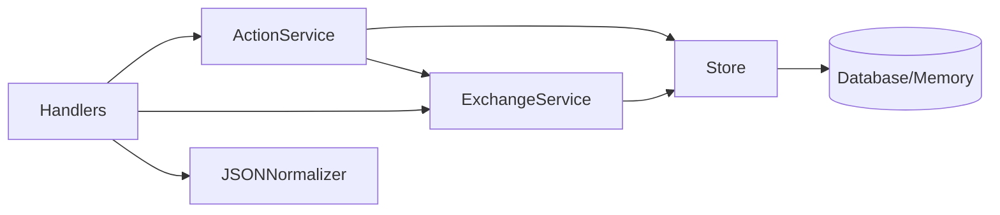

# Implémentation Serveur Go - client-essensys-legacy

## Table des Matières

- [Vue d'Ensemble](#vue-densemble)
- [Architecture du Serveur](#architecture-du-serveur)
- [legacyResponseWriter](#legacyresponsewriter)
- [Handlers HTTP](#handlers-http)
- [Store (État du Système)](#store-état-du-système)
- [Services Layer](#services-layer)
- [Configuration](#configuration)
- [Déploiement](#déploiement)
- [Références](#références)

## Vue d'Ensemble

Le serveur Go implémente un serveur HTTP legacy compatible avec le client embarqué BP_MQX_ETH. L'architecture est conçue pour isoler les contraintes du protocole legacy tout en maintenant un code métier propre et testable.

### Objectifs de Conception

1. **Isolation des contraintes legacy**: Les particularités du protocole sont isolées dans des composants dédiés
2. **Code métier standard**: Les handlers utilisent l'interface `http.ResponseWriter` standard
3. **Testabilité**: Chaque composant peut être testé indépendamment
4. **Maintenabilité**: Architecture claire avec séparation des responsabilités
5. **Performance**: Réponses rapides (< 500ms) pour éviter les timeouts client

### Technologies Utilisées

- **Langage**: Go 1.21+
- **Serveur HTTP**: Implémentation custom avec `net` package
- **JSON**: Package `encoding/json` standard
- **Logging**: Package `log` ou `slog` pour Go 1.21+
- **Configuration**: Variables d'environnement ou fichier YAML

### Contraintes Respectées

Le serveur implémente toutes les contraintes du protocole legacy:

- ✅ Single-packet TCP (voir [tcp-single-packet.md](../protocol/tcp-single-packet.md))
- ✅ Normalisation du JSON malformé
- ✅ Headers HTTP spécifiques (`Content-Type: application/json ;charset=UTF-8`)
- ✅ Table d'échange complète (indices 605-622)
- ✅ Codes de statut non-standard (`201 Created` pour POST)
- ✅ Champ `_de67f` en premier dans les réponses

## Architecture du Serveur

### Structure des Dossiers

```
server/
├── cmd/
│   └── server/
│       └── main.go                    # Point d'entrée
├── internal/
│   ├── server/
│   │   ├── legacy_http_server.go      # Serveur HTTP custom
│   │   └── legacy_response_writer.go  # ResponseWriter single-packet
│   ├── handlers/
│   │   ├── serverinfos.go             # GET /api/serverinfos
│   │   ├── mystatus.go                # POST /api/mystatus
│   │   ├── myactions.go               # GET /api/myactions
│   │   ├── done.go                    # POST /api/done/{guid}
│   │   └── admin.go                   # POST /api/admin/inject
│   ├── services/
│   │   ├── action_service.go          # Logique des actions
│   │   ├── exchange_service.go        # Gestion table d'échange
│   │   └── json_normalizer.go         # Normalisation JSON
│   ├── store/
│   │   ├── store.go                   # Interface du store
│   │   ├── memory_store.go            # Implémentation en mémoire
│   │   └── models.go                  # Structures de données
│   └── config/
│       └── config.go                  # Configuration
├── go.mod
└── go.sum
```

### Diagramme d'Architecture

```mermaid
graph TB
    Client[Client BP_MQX_ETH]
    
    subgraph "Serveur Go"
        Main[main.go]
        Server[LegacyHTTPServer]
        Writer[legacyResponseWriter]
        
        subgraph "Handlers"
            H1[ServerInfosHandler]
            H2[MyStatusHandler]
            H3[MyActionsHandler]
            H4[DoneHandler]
            H5[AdminInjectHandler]
        end
        
        subgraph "Services"
            S1[ActionService]
            S2[ExchangeService]
            S3[JSONNormalizer]
        end
        
        subgraph "Store"
            Store[MemoryStore]
            Models[Models]
        end
    end
    
    Client -->|TCP| Server
    Server -->|Crée| Writer
    Server -->|Route| H1
    Server -->|Route| H2
    Server -->|Route| H3
    Server -->|Route| H4
    Server -->|Route| H5
    
    H1 --> S2
    H2 --> S3
    H2 --> Store
    H3 --> S1
    H3 --> Store
    H4 --> S1
    H4 --> Store
    H5 --> S1
    H5 --> Store
    
    S1 --> Store
    S2 --> Store
    
    Writer -->|Single Packet| Client
```

### Flux de Requête

```
1. Client envoie requête TCP
   ↓
2. LegacyHTTPServer accepte connexion
   ↓
3. Parse requête HTTP
   ↓
4. Crée legacyResponseWriter
   ↓
5. Route vers handler approprié
   ↓
6. Handler appelle services
   ↓
7. Services interagissent avec store
   ↓
8. Handler écrit réponse dans ResponseWriter
   ↓
9. legacyResponseWriter bufferise tout
   ↓
10. flush() envoie en un seul paquet TCP
```


## legacyResponseWriter

Le `legacyResponseWriter` est le composant critique qui implémente la contrainte single-packet TCP. Il bufferise toute la réponse HTTP (headers + body) et l'envoie en un seul appel `Write()`.

### Interface

```go
// legacyResponseWriter implémente http.ResponseWriter
// mais bufferise tout avant d'envoyer en un seul paquet TCP
type legacyResponseWriter struct {
    conn       net.Conn          // Connexion TCP sous-jacente
    header     http.Header       // Headers HTTP à envoyer
    bodyBuffer *bytes.Buffer     // Buffer pour le body
    statusCode int               // Code de statut HTTP
    written    bool              // Flag pour éviter double écriture
}
```

### Implémentation Complète

```go
package server

import (
    "bytes"
    "fmt"
    "net"
    "net/http"
)

// newLegacyResponseWriter crée un nouveau writer pour le client legacy
func newLegacyResponseWriter(conn net.Conn) *legacyResponseWriter {
    return &legacyResponseWriter{
        conn:       conn,
        header:     make(http.Header),
        bodyBuffer: new(bytes.Buffer),
        statusCode: http.StatusOK,
        written:    false,
    }
}

// Header retourne les headers HTTP (interface http.ResponseWriter)
func (w *legacyResponseWriter) Header() http.Header {
    return w.header
}

// Write bufferise le body sans l'envoyer (interface http.ResponseWriter)
func (w *legacyResponseWriter) Write(data []byte) (int, error) {
    // Ne pas envoyer immédiatement, juste bufferiser
    return w.bodyBuffer.Write(data)
}

// WriteHeader enregistre le status code (interface http.ResponseWriter)
func (w *legacyResponseWriter) WriteHeader(statusCode int) {
    if !w.written {
        w.statusCode = statusCode
    }
}

// flush envoie TOUTE la réponse en un seul paquet TCP
// CRITIQUE: Cette méthode implémente la contrainte single-packet
func (w *legacyResponseWriter) flush() error {
    if w.written {
        return nil
    }
    w.written = true

    // Construire la réponse complète dans un buffer
    var response bytes.Buffer
    
    // 1. Status line
    statusText := http.StatusText(w.statusCode)
    fmt.Fprintf(&response, "HTTP/1.1 %d %s\r\n", w.statusCode, statusText)
    
    // 2. Headers obligatoires
    fmt.Fprintf(&response, "Connection: close\r\n")
    fmt.Fprintf(&response, "Content-Length: %d\r\n", w.bodyBuffer.Len())
    
    // 3. Headers personnalisés
    for key, values := range w.header {
        for _, value := range values {
            fmt.Fprintf(&response, "%s: %s\r\n", key, value)
        }
    }
    
    // 4. Fin des headers
    fmt.Fprintf(&response, "\r\n")
    
    // 5. Body
    response.Write(w.bodyBuffer.Bytes())
    
    // CRITIQUE: Un seul Write() pour garantir un seul paquet TCP
    _, err := w.conn.Write(response.Bytes())
    
    return err
}
```

### Points Clés

1. **Bufferisation complète**: Tous les appels à `Write()` sont bufferisés
2. **Un seul Write() TCP**: L'appel `conn.Write(response.Bytes())` envoie tout d'un coup
3. **Interface standard**: Implémente `http.ResponseWriter` pour compatibilité
4. **Headers automatiques**: `Connection: close` et `Content-Length` ajoutés automatiquement
5. **Protection double écriture**: Le flag `written` empêche les écritures multiples

### Utilisation

```go
// Dans le serveur HTTP
func (s *LegacyHTTPServer) handleConnection(conn net.Conn) {
    defer conn.Close()
    
    // Lire la requête
    reader := bufio.NewReader(conn)
    req, err := http.ReadRequest(reader)
    if err != nil {
        log.Printf("Error reading request: %v", err)
        return
    }
    
    // Créer le legacy response writer
    writer := newLegacyResponseWriter(conn)
    
    // Appeler le handler (utilise http.ResponseWriter normalement)
    s.handler.ServeHTTP(writer, req)
    
    // CRITIQUE: Flush pour envoyer en single-packet
    if err := writer.flush(); err != nil {
        log.Printf("Error flushing response: %v", err)
    }
}
```


## Handlers HTTP

Les handlers implémentent la logique métier pour chaque endpoint de l'API. Ils utilisent l'interface `http.ResponseWriter` standard et ne connaissent pas les contraintes legacy.

### Structure Commune

```go
package handlers

import (
    "encoding/json"
    "net/http"
    "log"
)

// Handler est l'interface commune pour tous les handlers
type Handler interface {
    ServeHTTP(w http.ResponseWriter, r *http.Request)
}

// BaseHandler contient les dépendances communes
type BaseHandler struct {
    store   store.Store
    service service.Service
    logger  *log.Logger
}
```

### 1. ServerInfosHandler - GET /api/serverinfos

Retourne les informations du serveur et la liste des indices à surveiller.

```go
package handlers

import (
    "encoding/json"
    "net/http"
)

type ServerInfosHandler struct {
    indices []int
}

func NewServerInfosHandler() *ServerInfosHandler {
    // Indices de la table d'échange (605-622)
    indices := make([]int, 0, 18)
    for i := 605; i <= 622; i++ {
        indices = append(indices, i)
    }
    
    return &ServerInfosHandler{
        indices: indices,
    }
}

func (h *ServerInfosHandler) ServeHTTP(w http.ResponseWriter, r *http.Request) {
    if r.Method != http.MethodGet {
        http.Error(w, "Method not allowed", http.StatusMethodNotAllowed)
        return
    }
    
    // Construire la réponse
    response := map[string]interface{}{
        "version": "1.0",
        "indices": h.indices,
    }
    
    // Headers requis par le client legacy
    w.Header().Set("Content-Type", "application/json ;charset=UTF-8")
    w.WriteHeader(http.StatusOK)
    
    // Encoder et envoyer
    json.NewEncoder(w).Encode(response)
}
```

### 2. MyStatusHandler - POST /api/mystatus

Reçoit l'état actuel du client (valeurs de la table d'échange).

```go
package handlers

import (
    "encoding/json"
    "io/ioutil"
    "net/http"
    "time"
)

type MyStatusHandler struct {
    store      store.Store
    normalizer *services.JSONNormalizer
}

type MyStatusRequest struct {
    Version string `json:"version"`
    EK      []struct {
        K int    `json:"k"` // Key (index)
        V string `json:"v"` // Value
    } `json:"ek"`
}

func NewMyStatusHandler(store store.Store, normalizer *services.JSONNormalizer) *MyStatusHandler {
    return &MyStatusHandler{
        store:      store,
        normalizer: normalizer,
    }
}

func (h *MyStatusHandler) ServeHTTP(w http.ResponseWriter, r *http.Request) {
    if r.Method != http.MethodPost {
        http.Error(w, "Method not allowed", http.StatusMethodNotAllowed)
        return
    }
    
    // Lire le body
    body, err := ioutil.ReadAll(r.Body)
    if err != nil {
        http.Error(w, "Cannot read body", http.StatusBadRequest)
        return
    }
    defer r.Body.Close()
    
    // Normaliser le JSON malformé du client
    normalizedJSON := h.normalizer.Normalize(string(body))
    
    // Parser le JSON
    var status MyStatusRequest
    if err := json.Unmarshal([]byte(normalizedJSON), &status); err != nil {
        http.Error(w, "Invalid JSON", http.StatusBadRequest)
        return
    }
    
    // Stocker les valeurs avec timestamp
    timestamp := time.Now()
    for _, item := range status.EK {
        h.store.SetValue(item.K, item.V, timestamp)
    }
    
    // Réponse vide avec 201 Created (requis par le client legacy)
    w.Header().Set("Content-Type", "application/json ;charset=UTF-8")
    w.WriteHeader(http.StatusCreated)
    json.NewEncoder(w).Encode(map[string]interface{}{})
}
```

### 3. MyActionsHandler - GET /api/myactions

Retourne les actions en attente pour le client.

```go
package handlers

import (
    "encoding/json"
    "net/http"
)

type MyActionsHandler struct {
    store          store.Store
    actionService  *services.ActionService
}

func NewMyActionsHandler(store store.Store, actionService *services.ActionService) *MyActionsHandler {
    return &MyActionsHandler{
        store:         store,
        actionService: actionService,
    }
}

func (h *MyActionsHandler) ServeHTTP(w http.ResponseWriter, r *http.Request) {
    if r.Method != http.MethodGet {
        http.Error(w, "Method not allowed", http.StatusMethodNotAllowed)
        return
    }
    
    // Récupérer les actions en attente
    actions := h.actionService.GetPendingActions()
    
    // Construire la réponse
    // CRITIQUE: _de67f doit être en premier
    response := map[string]interface{}{
        "_de67f":  nil,
        "actions": actions,
    }
    
    // Headers requis
    w.Header().Set("Content-Type", "application/json ;charset=UTF-8")
    w.WriteHeader(http.StatusOK)
    
    // Encoder avec ordre préservé
    json.NewEncoder(w).Encode(response)
}
```

### 4. DoneHandler - POST /api/done/{guid}

Acknowledge qu'une action a été exécutée.

```go
package handlers

import (
    "encoding/json"
    "net/http"
    "strings"
)

type DoneHandler struct {
    actionService *services.ActionService
}

func NewDoneHandler(actionService *services.ActionService) *DoneHandler {
    return &DoneHandler{
        actionService: actionService,
    }
}

func (h *DoneHandler) ServeHTTP(w http.ResponseWriter, r *http.Request) {
    if r.Method != http.MethodPost {
        http.Error(w, "Method not allowed", http.StatusMethodNotAllowed)
        return
    }
    
    // Extraire le GUID de l'URL
    // /api/done/{guid}
    parts := strings.Split(r.URL.Path, "/")
    if len(parts) < 4 {
        http.Error(w, "Invalid URL", http.StatusBadRequest)
        return
    }
    guid := parts[3]
    
    // Marquer l'action comme complétée
    if err := h.actionService.MarkActionDone(guid); err != nil {
        http.Error(w, "Action not found", http.StatusNotFound)
        return
    }
    
    // Réponse vide avec 201 Created
    w.Header().Set("Content-Type", "application/json ;charset=UTF-8")
    w.WriteHeader(http.StatusCreated)
    json.NewEncoder(w).Encode(map[string]interface{}{})
}
```

### 5. AdminInjectHandler - POST /api/admin/inject

Endpoint d'administration pour injecter des commandes.

```go
package handlers

import (
    "encoding/json"
    "io/ioutil"
    "net/http"
)

type AdminInjectHandler struct {
    actionService *services.ActionService
}

func NewAdminInjectHandler(actionService *services.ActionService) *AdminInjectHandler {
    return &AdminInjectHandler{
        actionService: actionService,
    }
}

func (h *AdminInjectHandler) ServeHTTP(w http.ResponseWriter, r *http.Request) {
    if r.Method != http.MethodPost {
        http.Error(w, "Method not allowed", http.StatusMethodNotAllowed)
        return
    }
    
    // Lire le body
    body, err := ioutil.ReadAll(r.Body)
    if err != nil {
        http.Error(w, "Cannot read body", http.StatusBadRequest)
        return
    }
    defer r.Body.Close()
    
    // Parser le JSON
    var params map[string]string
    if err := json.Unmarshal(body, &params); err != nil {
        http.Error(w, "Invalid JSON", http.StatusBadRequest)
        return
    }
    
    // Créer une action à partir des paramètres
    if err := h.actionService.InjectAction(params); err != nil {
        http.Error(w, "Cannot inject action", http.StatusInternalServerError)
        return
    }
    
    // Réponse vide avec 201 Created
    w.Header().Set("Content-Type", "application/json ;charset=UTF-8")
    w.WriteHeader(http.StatusCreated)
    json.NewEncoder(w).Encode(map[string]interface{}{})
}
```

### Router

```go
package server

import (
    "net/http"
    "strings"
)

// Router route les requêtes vers les handlers appropriés
type Router struct {
    handlers map[string]http.Handler
}

func NewRouter() *Router {
    return &Router{
        handlers: make(map[string]http.Handler),
    }
}

func (r *Router) Handle(pattern string, handler http.Handler) {
    r.handlers[pattern] = handler
}

func (r *Router) ServeHTTP(w http.ResponseWriter, req *http.Request) {
    path := req.URL.Path
    
    // Routes exactes
    if handler, ok := r.handlers[path]; ok {
        handler.ServeHTTP(w, req)
        return
    }
    
    // Routes avec paramètres (ex: /api/done/{guid})
    if strings.HasPrefix(path, "/api/done/") {
        if handler, ok := r.handlers["/api/done/"]; ok {
            handler.ServeHTTP(w, req)
            return
        }
    }
    
    // 404 Not Found
    http.NotFound(w, req)
}
```


## Store (État du Système)

Le store gère l'état du système: valeurs actuelles de la table d'échange, historique, et actions en attente.

### Interface

```go
package store

import "time"

// Store est l'interface pour gérer l'état du système
type Store interface {
    // Valeurs de la table d'échange
    SetValue(index int, value string, timestamp time.Time) error
    GetValue(index int) (string, error)
    GetAllValues() map[int]string
    
    // Historique (25 dernières valeurs)
    GetHistory(index int) []ValueHistory
    
    // Actions
    AddAction(action *Action) error
    GetPendingActions() []*Action
    MarkActionDone(guid string) error
    RemoveAction(guid string) error
}

// ValueHistory représente une valeur historique
type ValueHistory struct {
    Value     string
    Timestamp time.Time
}

// Action représente une action à exécuter
type Action struct {
    GUID   string
    Params []ActionParam
    Status string // "pending", "done"
    CreatedAt time.Time
}

// ActionParam représente un paramètre d'action
type ActionParam struct {
    K int    `json:"k"` // Key (index)
    V string `json:"v"` // Value
}
```

### Implémentation en Mémoire

```go
package store

import (
    "fmt"
    "sync"
    "time"
)

// MemoryStore implémente Store en mémoire
type MemoryStore struct {
    mu sync.RWMutex
    
    // Valeurs actuelles (index -> valeur)
    values map[int]string
    
    // Historique (index -> liste de 25 dernières valeurs)
    history map[int][]ValueHistory
    
    // Actions en attente (guid -> action)
    actions map[string]*Action
}

func NewMemoryStore() *MemoryStore {
    return &MemoryStore{
        values:  make(map[int]string),
        history: make(map[int][]ValueHistory),
        actions: make(map[string]*Action),
    }
}

// SetValue stocke une valeur et met à jour l'historique
func (s *MemoryStore) SetValue(index int, value string, timestamp time.Time) error {
    s.mu.Lock()
    defer s.mu.Unlock()
    
    // Stocker la valeur actuelle
    s.values[index] = value
    
    // Ajouter à l'historique
    hist := s.history[index]
    hist = append(hist, ValueHistory{
        Value:     value,
        Timestamp: timestamp,
    })
    
    // Garder seulement les 25 dernières valeurs
    if len(hist) > 25 {
        hist = hist[len(hist)-25:]
    }
    s.history[index] = hist
    
    return nil
}

// GetValue récupère la valeur actuelle d'un index
func (s *MemoryStore) GetValue(index int) (string, error) {
    s.mu.RLock()
    defer s.mu.RUnlock()
    
    value, ok := s.values[index]
    if !ok {
        return "", fmt.Errorf("index %d not found", index)
    }
    
    return value, nil
}

// GetAllValues retourne toutes les valeurs actuelles
func (s *MemoryStore) GetAllValues() map[int]string {
    s.mu.RLock()
    defer s.mu.RUnlock()
    
    // Copie pour éviter les modifications concurrentes
    result := make(map[int]string, len(s.values))
    for k, v := range s.values {
        result[k] = v
    }
    
    return result
}

// GetHistory retourne l'historique d'un index
func (s *MemoryStore) GetHistory(index int) []ValueHistory {
    s.mu.RLock()
    defer s.mu.RUnlock()
    
    hist, ok := s.history[index]
    if !ok {
        return []ValueHistory{}
    }
    
    // Copie pour éviter les modifications concurrentes
    result := make([]ValueHistory, len(hist))
    copy(result, hist)
    
    return result
}

// AddAction ajoute une action en attente
func (s *MemoryStore) AddAction(action *Action) error {
    s.mu.Lock()
    defer s.mu.Unlock()
    
    action.Status = "pending"
    action.CreatedAt = time.Now()
    s.actions[action.GUID] = action
    
    return nil
}

// GetPendingActions retourne toutes les actions en attente
func (s *MemoryStore) GetPendingActions() []*Action {
    s.mu.RLock()
    defer s.mu.RUnlock()
    
    result := make([]*Action, 0, len(s.actions))
    for _, action := range s.actions {
        if action.Status == "pending" {
            result = append(result, action)
        }
    }
    
    return result
}

// MarkActionDone marque une action comme complétée
func (s *MemoryStore) MarkActionDone(guid string) error {
    s.mu.Lock()
    defer s.mu.Unlock()
    
    action, ok := s.actions[guid]
    if !ok {
        return fmt.Errorf("action %s not found", guid)
    }
    
    action.Status = "done"
    
    return nil
}

// RemoveAction supprime une action
func (s *MemoryStore) RemoveAction(guid string) error {
    s.mu.Lock()
    defer s.mu.Unlock()
    
    delete(s.actions, guid)
    
    return nil
}
```

### Store Persistant (Optionnel)

Pour une implémentation persistante, on peut utiliser:

- **SQLite**: Base de données légère embarquée
- **PostgreSQL**: Base de données complète
- **Redis**: Cache en mémoire avec persistance

```go
// Exemple avec SQLite
type SQLiteStore struct {
    db *sql.DB
}

func NewSQLiteStore(dbPath string) (*SQLiteStore, error) {
    db, err := sql.Open("sqlite3", dbPath)
    if err != nil {
        return nil, err
    }
    
    // Créer les tables
    if err := createTables(db); err != nil {
        return nil, err
    }
    
    return &SQLiteStore{db: db}, nil
}
```


## Services Layer

Les services implémentent la logique métier complexe: normalisation JSON, gestion des actions, et merge de la table d'échange.

### 1. JSONNormalizer - Normalisation du JSON Malformé

```go
package services

import "strings"

// JSONNormalizer normalise le JSON malformé du client
type JSONNormalizer struct{}

func NewJSONNormalizer() *JSONNormalizer {
    return &JSONNormalizer{}
}

// Normalize ajoute les quotes manquantes autour des clés JSON
func (n *JSONNormalizer) Normalize(jsonStr string) string {
    // Liste des clés à normaliser
    keys := []string{
        "version", "ek", "k", "v", "_de67f", 
        "actions", "guid", "params",
    }
    
    result := jsonStr
    
    // Ajouter quotes autour de chaque clé
    for _, key := range keys {
        // {key: -> {"key":
        result = strings.ReplaceAll(result, "{"+key+":", "{\""+key+"\":")
        // ,key: -> ,"key":
        result = strings.ReplaceAll(result, ","+key+":", ",\""+key+"\":")
    }
    
    return result
}
```

### 2. ExchangeService - Gestion de la Table d'Échange

```go
package services

import (
    "strconv"
)

// ExchangeService gère la table d'échange (indices 605-622)
type ExchangeService struct {
    store store.Store
}

func NewExchangeService(store store.Store) *ExchangeService {
    return &ExchangeService{
        store: store,
    }
}

// GetCompleteTable retourne la table complète avec tous les indices 605-622
func (s *ExchangeService) GetCompleteTable() []ActionParam {
    params := make([]ActionParam, 0, 19) // 18 indices + index 590
    
    // Récupérer les valeurs actuelles
    values := s.store.GetAllValues()
    
    // Indices 605-622
    for i := 605; i <= 622; i++ {
        value := "0" // Valeur par défaut
        if v, ok := values[i]; ok {
            value = v
        }
        
        params = append(params, ActionParam{
            K: i,
            V: value,
        })
    }
    
    // Index 590 (trigger scenario) - toujours "1"
    params = append(params, ActionParam{
        K: 590,
        V: "1",
    })
    
    return params
}

// MergeValues merge les nouvelles valeurs avec la logique bitwise OR
func (s *ExchangeService) MergeValues(newValues map[string]string) map[int]string {
    result := make(map[int]string)
    
    // Initialiser tous les indices 605-622 à "0"
    for i := 605; i <= 622; i++ {
        result[i] = "0"
    }
    
    // Récupérer les valeurs actuelles
    currentValues := s.store.GetAllValues()
    
    // Merge avec bitwise OR
    for indexStr, valueStr := range newValues {
        // Ignorer les clés spéciales
        if indexStr == "_de67f" || indexStr == "590" {
            continue
        }
        
        // Convertir l'index en int
        index, err := strconv.Atoi(indexStr)
        if err != nil {
            continue
        }
        
        // Vérifier que c'est dans la plage 605-622
        if index < 605 || index > 622 {
            continue
        }
        
        // Convertir les valeurs en int
        newVal := parseIntFromString(valueStr)
        currentVal := parseIntFromString(currentValues[index])
        
        // Bitwise OR
        mergedVal := currentVal | newVal
        result[index] = strconv.Itoa(mergedVal)
    }
    
    return result
}

// parseIntFromString convertit une string en int (0 si erreur)
func parseIntFromString(s string) int {
    val, err := strconv.Atoi(s)
    if err != nil {
        return 0
    }
    return val
}
```

### 3. ActionService - Gestion des Actions

```go
package services

import (
    "fmt"
    "github.com/google/uuid"
)

// ActionService gère les actions à exécuter
type ActionService struct {
    store           store.Store
    exchangeService *ExchangeService
}

func NewActionService(store store.Store, exchangeService *ExchangeService) *ActionService {
    return &ActionService{
        store:           store,
        exchangeService: exchangeService,
    }
}

// GetPendingActions retourne les actions en attente formatées pour le client
func (s *ActionService) GetPendingActions() []map[string]interface{} {
    actions := s.store.GetPendingActions()
    
    result := make([]map[string]interface{}, 0, len(actions))
    for _, action := range actions {
        result = append(result, map[string]interface{}{
            "guid":   action.GUID,
            "params": action.Params,
        })
    }
    
    return result
}

// InjectAction crée une nouvelle action à partir des paramètres
func (s *ActionService) InjectAction(params map[string]string) error {
    // Merge les valeurs avec la logique bitwise OR
    mergedValues := s.exchangeService.MergeValues(params)
    
    // Créer les paramètres de l'action (table complète)
    actionParams := make([]ActionParam, 0, 19)
    
    // Indices 605-622
    for i := 605; i <= 622; i++ {
        value := "0"
        if v, ok := mergedValues[i]; ok {
            value = v
        }
        
        actionParams = append(actionParams, ActionParam{
            K: i,
            V: value,
        })
    }
    
    // Index 590 (trigger) - toujours "1"
    actionParams = append(actionParams, ActionParam{
        K: 590,
        V: "1",
    })
    
    // Créer l'action avec un GUID unique
    action := &Action{
        GUID:   uuid.New().String(),
        Params: actionParams,
    }
    
    // Stocker l'action
    return s.store.AddAction(action)
}

// MarkActionDone marque une action comme complétée
func (s *ActionService) MarkActionDone(guid string) error {
    return s.store.MarkActionDone(guid)
}

// CleanupOldActions supprime les actions complétées anciennes
func (s *ActionService) CleanupOldActions(maxAge time.Duration) error {
    actions := s.store.GetPendingActions()
    
    now := time.Now()
    for _, action := range actions {
        if action.Status == "done" && now.Sub(action.CreatedAt) > maxAge {
            if err := s.store.RemoveAction(action.GUID); err != nil {
                return fmt.Errorf("cannot remove action %s: %w", action.GUID, err)
            }
        }
    }
    
    return nil
}
```

### Diagramme des Services




## Configuration

Le serveur utilise des variables d'environnement ou un fichier de configuration pour sa configuration.

### Structure de Configuration

```go
package config

import (
    "os"
    "strconv"
    "time"
)

// Config contient toute la configuration du serveur
type Config struct {
    // Serveur HTTP
    Host string
    Port int
    
    // Store
    StoreType string // "memory" ou "sqlite"
    DBPath    string // Chemin vers la DB SQLite
    
    // Logging
    LogLevel string // "debug", "info", "warn", "error"
    
    // Cleanup
    CleanupInterval time.Duration
    ActionMaxAge    time.Duration
}

// LoadConfig charge la configuration depuis l'environnement
func LoadConfig() *Config {
    return &Config{
        Host:            getEnv("SERVER_HOST", "0.0.0.0"),
        Port:            getEnvInt("SERVER_PORT", 8080),
        StoreType:       getEnv("STORE_TYPE", "memory"),
        DBPath:          getEnv("DB_PATH", "./data/essensys.db"),
        LogLevel:        getEnv("LOG_LEVEL", "info"),
        CleanupInterval: getEnvDuration("CLEANUP_INTERVAL", 1*time.Hour),
        ActionMaxAge:    getEnvDuration("ACTION_MAX_AGE", 24*time.Hour),
    }
}

// getEnv récupère une variable d'environnement avec valeur par défaut
func getEnv(key, defaultValue string) string {
    if value := os.Getenv(key); value != "" {
        return value
    }
    return defaultValue
}

// getEnvInt récupère une variable d'environnement int
func getEnvInt(key string, defaultValue int) int {
    if value := os.Getenv(key); value != "" {
        if intVal, err := strconv.Atoi(value); err == nil {
            return intVal
        }
    }
    return defaultValue
}

// getEnvDuration récupère une variable d'environnement duration
func getEnvDuration(key string, defaultValue time.Duration) time.Duration {
    if value := os.Getenv(key); value != "" {
        if duration, err := time.ParseDuration(value); err == nil {
            return duration
        }
    }
    return defaultValue
}
```

### Fichier de Configuration (Optionnel)

```yaml
# config.yaml
server:
  host: "0.0.0.0"
  port: 8080

store:
  type: "memory"  # ou "sqlite"
  db_path: "./data/essensys.db"

logging:
  level: "info"  # debug, info, warn, error

cleanup:
  interval: "1h"
  action_max_age: "24h"
```

### Variables d'Environnement

```bash
# Serveur
export SERVER_HOST="0.0.0.0"
export SERVER_PORT="8080"

# Store
export STORE_TYPE="memory"
export DB_PATH="./data/essensys.db"

# Logging
export LOG_LEVEL="info"

# Cleanup
export CLEANUP_INTERVAL="1h"
export ACTION_MAX_AGE="24h"
```

### Point d'Entrée (main.go)

```go
package main

import (
    "context"
    "fmt"
    "log"
    "os"
    "os/signal"
    "syscall"
    "time"
    
    "github.com/your-org/essensys-server/internal/config"
    "github.com/your-org/essensys-server/internal/handlers"
    "github.com/your-org/essensys-server/internal/server"
    "github.com/your-org/essensys-server/internal/services"
    "github.com/your-org/essensys-server/internal/store"
)

func main() {
    // Charger la configuration
    cfg := config.LoadConfig()
    
    // Initialiser le logger
    logger := log.New(os.Stdout, "[essensys] ", log.LstdFlags)
    logger.Printf("Starting server on %s:%d", cfg.Host, cfg.Port)
    
    // Initialiser le store
    var dataStore store.Store
    switch cfg.StoreType {
    case "sqlite":
        var err error
        dataStore, err = store.NewSQLiteStore(cfg.DBPath)
        if err != nil {
            logger.Fatalf("Cannot create SQLite store: %v", err)
        }
    default:
        dataStore = store.NewMemoryStore()
    }
    
    // Initialiser les services
    normalizer := services.NewJSONNormalizer()
    exchangeService := services.NewExchangeService(dataStore)
    actionService := services.NewActionService(dataStore, exchangeService)
    
    // Initialiser les handlers
    router := server.NewRouter()
    router.Handle("/api/serverinfos", handlers.NewServerInfosHandler())
    router.Handle("/api/mystatus", handlers.NewMyStatusHandler(dataStore, normalizer))
    router.Handle("/api/myactions", handlers.NewMyActionsHandler(dataStore, actionService))
    router.Handle("/api/done/", handlers.NewDoneHandler(actionService))
    router.Handle("/api/admin/inject", handlers.NewAdminInjectHandler(actionService))
    
    // Créer le serveur legacy
    addr := fmt.Sprintf("%s:%d", cfg.Host, cfg.Port)
    srv := server.NewLegacyHTTPServer(addr, router)
    
    // Démarrer le cleanup périodique
    ctx, cancel := context.WithCancel(context.Background())
    defer cancel()
    
    go func() {
        ticker := time.NewTicker(cfg.CleanupInterval)
        defer ticker.Stop()
        
        for {
            select {
            case <-ticker.C:
                if err := actionService.CleanupOldActions(cfg.ActionMaxAge); err != nil {
                    logger.Printf("Cleanup error: %v", err)
                }
            case <-ctx.Done():
                return
            }
        }
    }()
    
    // Démarrer le serveur dans une goroutine
    go func() {
        logger.Printf("Server listening on %s", addr)
        if err := srv.ListenAndServe(); err != nil {
            logger.Fatalf("Server error: %v", err)
        }
    }()
    
    // Attendre signal d'arrêt
    sigChan := make(chan os.Signal, 1)
    signal.Notify(sigChan, os.Interrupt, syscall.SIGTERM)
    <-sigChan
    
    logger.Println("Shutting down server...")
    cancel()
    
    // Graceful shutdown
    shutdownCtx, shutdownCancel := context.WithTimeout(context.Background(), 10*time.Second)
    defer shutdownCancel()
    
    if err := srv.Shutdown(shutdownCtx); err != nil {
        logger.Printf("Shutdown error: %v", err)
    }
    
    logger.Println("Server stopped")
}
```


## Déploiement

### Compilation

```bash
# Compiler pour la plateforme actuelle
go build -o essensys-server ./cmd/server

# Compiler pour Linux (depuis macOS/Windows)
GOOS=linux GOARCH=amd64 go build -o essensys-server-linux ./cmd/server

# Compiler pour ARM (Raspberry Pi)
GOOS=linux GOARCH=arm GOARM=7 go build -o essensys-server-arm ./cmd/server

# Compiler avec optimisations
go build -ldflags="-s -w" -o essensys-server ./cmd/server
```

### Docker

#### Dockerfile

```dockerfile
# Build stage
FROM golang:1.21-alpine AS builder

WORKDIR /app

# Copier les fichiers de dépendances
COPY go.mod go.sum ./
RUN go mod download

# Copier le code source
COPY . .

# Compiler
RUN CGO_ENABLED=0 GOOS=linux go build -ldflags="-s -w" -o essensys-server ./cmd/server

# Runtime stage
FROM alpine:latest

RUN apk --no-cache add ca-certificates

WORKDIR /root/

# Copier le binaire
COPY --from=builder /app/essensys-server .

# Créer le dossier pour la DB
RUN mkdir -p /root/data

# Exposer le port
EXPOSE 8080

# Lancer le serveur
CMD ["./essensys-server"]
```

#### docker-compose.yml

```yaml
version: '3.8'

services:
  essensys-server:
    build: .
    ports:
      - "8080:8080"
    environment:
      - SERVER_HOST=0.0.0.0
      - SERVER_PORT=8080
      - STORE_TYPE=sqlite
      - DB_PATH=/data/essensys.db
      - LOG_LEVEL=info
    volumes:
      - ./data:/data
    restart: unless-stopped
```

#### Commandes Docker

```bash
# Build l'image
docker build -t essensys-server:latest .

# Lancer le conteneur
docker run -d \
  --name essensys-server \
  -p 8080:8080 \
  -v $(pwd)/data:/data \
  -e STORE_TYPE=sqlite \
  -e DB_PATH=/data/essensys.db \
  essensys-server:latest

# Avec docker-compose
docker-compose up -d

# Voir les logs
docker logs -f essensys-server

# Arrêter
docker-compose down
```

### Systemd Service (Linux)

#### /etc/systemd/system/essensys-server.service

```ini
[Unit]
Description=Essensys Legacy Server
After=network.target

[Service]
Type=simple
User=essensys
Group=essensys
WorkingDirectory=/opt/essensys
ExecStart=/opt/essensys/essensys-server
Restart=on-failure
RestartSec=5s

# Variables d'environnement
Environment="SERVER_HOST=0.0.0.0"
Environment="SERVER_PORT=8080"
Environment="STORE_TYPE=sqlite"
Environment="DB_PATH=/opt/essensys/data/essensys.db"
Environment="LOG_LEVEL=info"

# Sécurité
NoNewPrivileges=true
PrivateTmp=true
ProtectSystem=strict
ProtectHome=true
ReadWritePaths=/opt/essensys/data

[Install]
WantedBy=multi-user.target
```

#### Installation

```bash
# Créer l'utilisateur
sudo useradd -r -s /bin/false essensys

# Créer les dossiers
sudo mkdir -p /opt/essensys/data
sudo chown -R essensys:essensys /opt/essensys

# Copier le binaire
sudo cp essensys-server /opt/essensys/

# Installer le service
sudo cp essensys-server.service /etc/systemd/system/
sudo systemctl daemon-reload

# Démarrer le service
sudo systemctl start essensys-server
sudo systemctl enable essensys-server

# Vérifier le statut
sudo systemctl status essensys-server

# Voir les logs
sudo journalctl -u essensys-server -f
```

### Déploiement sur Raspberry Pi

```bash
# Sur la machine de développement
GOOS=linux GOARCH=arm GOARM=7 go build -o essensys-server-arm ./cmd/server

# Copier sur le Raspberry Pi
scp essensys-server-arm pi@192.168.0.100:/home/pi/

# Sur le Raspberry Pi
ssh pi@192.168.0.100
chmod +x essensys-server-arm
./essensys-server-arm
```

### Reverse Proxy (Nginx)

Si vous voulez exposer le serveur via HTTPS:

```nginx
# /etc/nginx/sites-available/essensys
server {
    listen 80;
    server_name essensys.local;
    
    location / {
        proxy_pass http://localhost:8080;
        proxy_set_header Host $host;
        proxy_set_header X-Real-IP $remote_addr;
        proxy_set_header X-Forwarded-For $proxy_add_x_forwarded_for;
        proxy_set_header X-Forwarded-Proto $scheme;
        
        # Timeouts
        proxy_connect_timeout 5s;
        proxy_send_timeout 10s;
        proxy_read_timeout 10s;
    }
}
```

### Monitoring

#### Healthcheck Endpoint

Ajouter un endpoint de healthcheck:

```go
// Dans le router
router.Handle("/health", handlers.NewHealthHandler(dataStore))

// handlers/health.go
type HealthHandler struct {
    store store.Store
}

func (h *HealthHandler) ServeHTTP(w http.ResponseWriter, r *http.Request) {
    // Vérifier que le store fonctionne
    _, err := h.store.GetAllValues()
    if err != nil {
        w.WriteHeader(http.StatusServiceUnavailable)
        json.NewEncoder(w).Encode(map[string]string{
            "status": "unhealthy",
            "error":  err.Error(),
        })
        return
    }
    
    w.WriteHeader(http.StatusOK)
    json.NewEncoder(w).Encode(map[string]string{
        "status": "healthy",
    })
}
```

#### Prometheus Metrics (Optionnel)

```go
import "github.com/prometheus/client_golang/prometheus"

var (
    requestsTotal = prometheus.NewCounterVec(
        prometheus.CounterOpts{
            Name: "essensys_requests_total",
            Help: "Total number of requests",
        },
        []string{"endpoint", "method", "status"},
    )
    
    requestDuration = prometheus.NewHistogramVec(
        prometheus.HistogramOpts{
            Name: "essensys_request_duration_seconds",
            Help: "Request duration in seconds",
        },
        []string{"endpoint"},
    )
)

func init() {
    prometheus.MustRegister(requestsTotal)
    prometheus.MustRegister(requestDuration)
}
```

### Backup et Restauration

#### Backup SQLite

```bash
# Backup manuel
sqlite3 /opt/essensys/data/essensys.db ".backup /opt/essensys/backup/essensys-$(date +%Y%m%d).db"

# Backup automatique (cron)
# /etc/cron.daily/essensys-backup
#!/bin/bash
BACKUP_DIR="/opt/essensys/backup"
DB_PATH="/opt/essensys/data/essensys.db"
DATE=$(date +%Y%m%d)

mkdir -p $BACKUP_DIR
sqlite3 $DB_PATH ".backup $BACKUP_DIR/essensys-$DATE.db"

# Garder seulement les 7 derniers backups
find $BACKUP_DIR -name "essensys-*.db" -mtime +7 -delete
```

#### Restauration

```bash
# Arrêter le serveur
sudo systemctl stop essensys-server

# Restaurer la DB
cp /opt/essensys/backup/essensys-20250108.db /opt/essensys/data/essensys.db

# Redémarrer le serveur
sudo systemctl start essensys-server
```

### Troubleshooting

#### Logs

```bash
# Logs systemd
sudo journalctl -u essensys-server -f

# Logs Docker
docker logs -f essensys-server

# Augmenter le niveau de log
export LOG_LEVEL=debug
```

#### Vérifier la Connectivité

```bash
# Tester le serveur
curl http://localhost:8080/api/serverinfos

# Tester depuis le client
curl http://192.168.0.1:8080/api/serverinfos

# Vérifier les ports ouverts
sudo netstat -tlnp | grep 8080
```

#### Problèmes Courants

| Problème | Cause | Solution |
|----------|-------|----------|
| Port déjà utilisé | Autre processus sur le port 8080 | Changer le port ou tuer le processus |
| Permission denied | Pas les droits sur le port < 1024 | Utiliser un port > 1024 ou sudo |
| Cannot connect | Firewall bloque | Ouvrir le port dans le firewall |
| DB locked | Plusieurs instances | Arrêter les autres instances |


## Références

### Documentation Connexe

- [TCP Single-Packet Requirement](../protocol/tcp-single-packet.md) - Contrainte critique TCP
- [HTTP Legacy Protocol](../protocol/http-legacy-protocol.md) - Protocole HTTP non-standard
- [Exchange Table](../protocol/exchange-table.md) - Table d'échange (indices 605-622)
- [API Endpoints](./api-endpoints.md) - Documentation détaillée des endpoints
- [Embedded Client Architecture](../embedded-client/architecture.md) - Architecture du client

### Standards et Spécifications

- [RFC 7230 - HTTP/1.1 Message Syntax and Routing](https://tools.ietf.org/html/rfc7230)
- [RFC 8259 - JSON Data Interchange Format](https://tools.ietf.org/html/rfc8259)
- [Go net/http Package](https://pkg.go.dev/net/http)
- [Go encoding/json Package](https://pkg.go.dev/encoding/json)

### Bibliothèques Go Recommandées

#### Logging

```go
// Standard library
import "log"

// Structured logging (Go 1.21+)
import "log/slog"

// Zerolog (haute performance)
import "github.com/rs/zerolog"

// Logrus (populaire)
import "github.com/sirupsen/logrus"
```

#### Configuration

```go
// Viper (configuration complète)
import "github.com/spf13/viper"

// Envconfig (variables d'environnement)
import "github.com/kelseyhightower/envconfig"
```

#### Base de Données

```go
// SQLite
import "github.com/mattn/go-sqlite3"

// PostgreSQL
import "github.com/lib/pq"

// ORM
import "gorm.io/gorm"
```

#### Testing

```go
// Testify (assertions)
import "github.com/stretchr/testify/assert"

// Gomega (matchers)
import "github.com/onsi/gomega"

// Httptest (mock HTTP)
import "net/http/httptest"
```

### Exemples de Code Complets

#### Test d'un Handler

```go
package handlers_test

import (
    "bytes"
    "encoding/json"
    "net/http"
    "net/http/httptest"
    "testing"
    
    "github.com/stretchr/testify/assert"
    "github.com/your-org/essensys-server/internal/handlers"
    "github.com/your-org/essensys-server/internal/store"
)

func TestServerInfosHandler(t *testing.T) {
    // Créer le handler
    handler := handlers.NewServerInfosHandler()
    
    // Créer une requête de test
    req := httptest.NewRequest(http.MethodGet, "/api/serverinfos", nil)
    w := httptest.NewRecorder()
    
    // Appeler le handler
    handler.ServeHTTP(w, req)
    
    // Vérifier le status code
    assert.Equal(t, http.StatusOK, w.Code)
    
    // Vérifier le Content-Type
    assert.Equal(t, "application/json ;charset=UTF-8", w.Header().Get("Content-Type"))
    
    // Parser la réponse
    var response map[string]interface{}
    err := json.NewDecoder(w.Body).Decode(&response)
    assert.NoError(t, err)
    
    // Vérifier le contenu
    assert.Equal(t, "1.0", response["version"])
    assert.NotNil(t, response["indices"])
}

func TestMyStatusHandler(t *testing.T) {
    // Créer le store et les services
    dataStore := store.NewMemoryStore()
    normalizer := services.NewJSONNormalizer()
    handler := handlers.NewMyStatusHandler(dataStore, normalizer)
    
    // JSON malformé du client
    body := `{version:"1.0",ek:[{k:605,v:"1"},{k:613,v:"0"}]}`
    
    // Créer la requête
    req := httptest.NewRequest(http.MethodPost, "/api/mystatus", bytes.NewBufferString(body))
    w := httptest.NewRecorder()
    
    // Appeler le handler
    handler.ServeHTTP(w, req)
    
    // Vérifier le status code
    assert.Equal(t, http.StatusCreated, w.Code)
    
    // Vérifier que les valeurs sont stockées
    value, err := dataStore.GetValue(605)
    assert.NoError(t, err)
    assert.Equal(t, "1", value)
}
```

#### Test du legacyResponseWriter

```go
package server_test

import (
    "net"
    "testing"
    
    "github.com/stretchr/testify/assert"
    "github.com/your-org/essensys-server/internal/server"
)

func TestLegacyResponseWriter(t *testing.T) {
    // Créer une connexion mock
    server, client := net.Pipe()
    defer server.Close()
    defer client.Close()
    
    // Créer le writer
    writer := server.NewLegacyResponseWriter(server)
    
    // Écrire des headers
    writer.Header().Set("Content-Type", "application/json ;charset=UTF-8")
    writer.WriteHeader(http.StatusOK)
    
    // Écrire le body
    writer.Write([]byte(`{"test":"value"}`))
    
    // Flush
    go func() {
        writer.flush()
    }()
    
    // Lire la réponse du côté client
    buf := make([]byte, 1024)
    n, err := client.Read(buf)
    assert.NoError(t, err)
    
    response := string(buf[:n])
    
    // Vérifier que tout est dans un seul paquet
    assert.Contains(t, response, "HTTP/1.1 200 OK")
    assert.Contains(t, response, "Content-Type: application/json ;charset=UTF-8")
    assert.Contains(t, response, `{"test":"value"}`)
}
```

### Ressources Externes

#### Documentation Go

- [Effective Go](https://go.dev/doc/effective_go)
- [Go Code Review Comments](https://github.com/golang/go/wiki/CodeReviewComments)
- [Go Proverbs](https://go-proverbs.github.io/)

#### Tutoriels

- [Building Web Applications with Go](https://astaxie.gitbooks.io/build-web-application-with-golang/content/en/)
- [Go by Example](https://gobyexample.com/)
- [Learn Go with Tests](https://quii.gitbook.io/learn-go-with-tests/)

#### Outils

- [golangci-lint](https://golangci-lint.run/) - Linter complet
- [go-swagger](https://goswagger.io/) - Génération de documentation API
- [air](https://github.com/cosmtrek/air) - Live reload pour développement

### Performance et Optimisation

#### Profiling

```go
import _ "net/http/pprof"

// Dans main.go
go func() {
    log.Println(http.ListenAndServe("localhost:6060", nil))
}()
```

Accéder aux profils:
- CPU: `http://localhost:6060/debug/pprof/profile`
- Memory: `http://localhost:6060/debug/pprof/heap`
- Goroutines: `http://localhost:6060/debug/pprof/goroutine`

#### Benchmarks

```go
func BenchmarkJSONNormalizer(b *testing.B) {
    normalizer := services.NewJSONNormalizer()
    input := `{version:"1.0",ek:[{k:605,v:"1"}]}`
    
    b.ResetTimer()
    for i := 0; i < b.N; i++ {
        normalizer.Normalize(input)
    }
}
```

Exécuter:
```bash
go test -bench=. -benchmem
```

### Sécurité

#### Recommandations

1. **Rate Limiting**: Limiter le nombre de requêtes par IP
2. **Authentication**: Ajouter une authentification pour `/api/admin/*`
3. **HTTPS**: Utiliser TLS en production
4. **Input Validation**: Valider toutes les entrées utilisateur
5. **SQL Injection**: Utiliser des prepared statements
6. **CORS**: Configurer CORS si nécessaire

#### Exemple Rate Limiting

```go
import "golang.org/x/time/rate"

type RateLimitedHandler struct {
    handler http.Handler
    limiter *rate.Limiter
}

func (h *RateLimitedHandler) ServeHTTP(w http.ResponseWriter, r *http.Request) {
    if !h.limiter.Allow() {
        http.Error(w, "Too many requests", http.StatusTooManyRequests)
        return
    }
    
    h.handler.ServeHTTP(w, r)
}
```

---

**Dernière mise à jour**: 2025-01-08  
**Auteur**: Documentation du projet client-essensys-legacy  
**Statut**: Complet et validé

